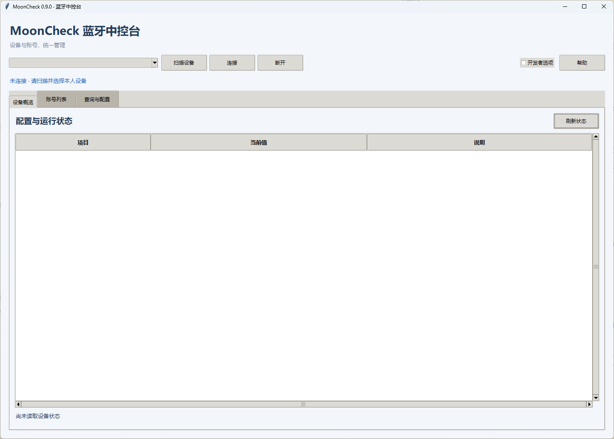
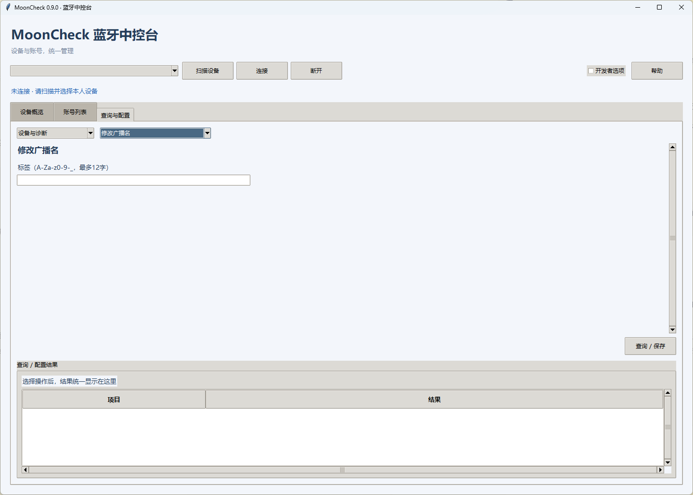
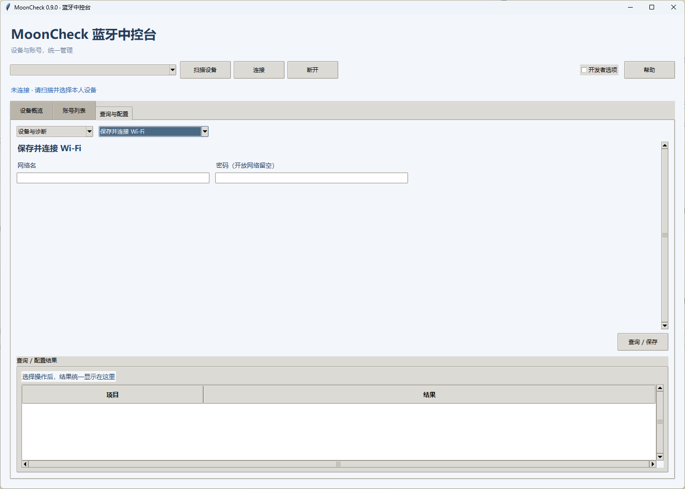
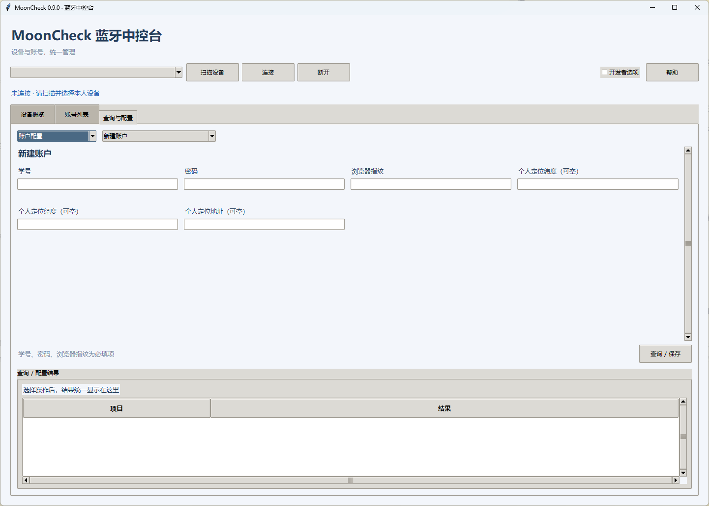
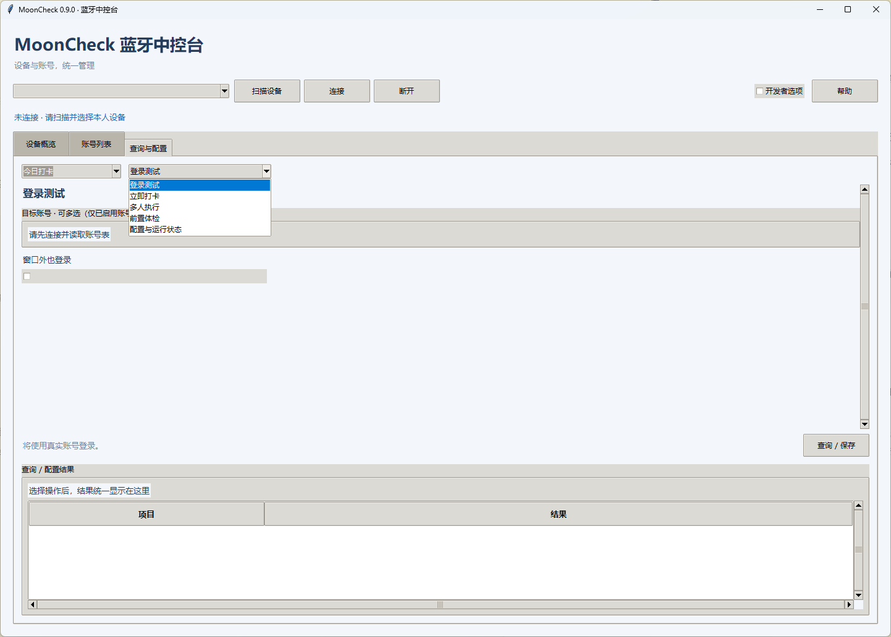
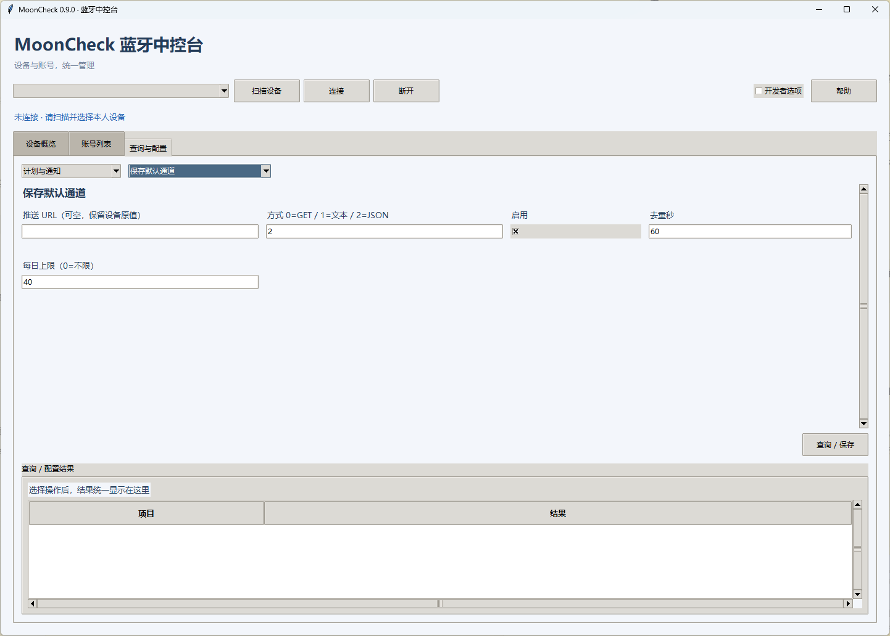

# MoonCheck

MoonCheck 为电子科技大学「晚安成电」提供自动打卡。为 ESP32 保持供电、联网，设备就会按计划运行，省去每天定时定点手动打开页面的操作。支持组长小组确认和个人定位打卡。

[下载 v0.9.0 固件与电脑蓝牙中控台](https://github.com/richard297779/UESTC-MoonCheck/releases/tag/v0.9.0)

## 安全说明

- **组长**每天确认每位组员都能正常联系。联系不上或情况待核实时，先暂停当次自动任务，按学校要求核实和上报。
- **个人打卡**使用本人账号，确保自己当晚保持可联系。地点或实际情况变化时，及时按学校要求人工处理。
- 按学校规定使用。只在受控环境配置自己的设备，妥善保管密码、浏览器指纹、微信凭据和推送密钥。

## 项目目录

| 目录 | 用途 |
| --- | --- |
| [firmware/](firmware/) | ESP32 固件、板型配置和构建 |
| [tools/](tools/) | 电脑蓝牙中控台及辅助工具 |
| [android/](android/) | Android 蓝牙控制端 |
| [desktop/](desktop/) | 独立运行的 Windows / Linux 桌面程序 |
| [docs/](docs/) · [dev/](dev/) · [release/](release/) | 使用文档、开发文档和发行说明 |

## 快速开始

### 烧录 ESP32 固件

1. 从 [v0.9.0 发行页](https://github.com/richard297779/UESTC-MoonCheck/releases/tag/v0.9.0) 下载与开发板匹配的固件。S3-N16R8 选文件名含 `s3-n16r8` 的版本，经典 WROOM-32 选 `wroom32-4mb`。
2. 用 USB 数据线连接开发板，在 Chrome 或 Edge 打开 [Espressif 网页烧录工具](https://espressif.github.io/esptool-js/)。点击 **Connect**，选择串口。
3. 首次安装选对应的 `…-merged.bin` 镜像，地址填 `0x0`。**全量烧录会清除已有配置。** 若是同板型、同分区表升级，只烧录对应 `…-full.zip` 内的 `firmware.bin` 到 `0x10000`，并保持 **Erase all** 未勾选。
4. 点击 **Program**，校验完成后断开串口，按板上的 **RST / EN** 复位。串口连不上时，参见[烧录指南](docs/flashing.md)。

### 使用电脑蓝牙中控台

解压发行页的 `MoonCheck-0.9.0-ble-console-source.zip`。电脑安装 Python 3.10+（含 tkinter）后，在解压目录中安装依赖，然后双击 `tools/ble_console.pyw`。

```powershell
python -m pip install -r tools/requirements-ble.txt
```

#### 1. 扫描并连接

开启电脑蓝牙，让 ESP32 保持上电。点击「扫描设备」，在下拉框选自己的 `WANAN-…`，再点「连接」。附近有多块板时，核对名称和设备地址。



#### 2. 查看设备信息

连接后打开「设备概览」，点击「刷新状态」。这里可以核对设备名称、固件版本、已连接网络、设备时间和打卡计划。如需区分多块板，可在「查询与配置 → 设备与诊断 → 修改广播名」保存一个好认的标签。

<details>
<summary>查看修改广播名界面</summary>



</details>

#### 3. 连接网络

在「查询与配置 → 设备与诊断 → 保存并连接 Wi-Fi」填写可访问学校平台的 **2.4 GHz** 网络名和密码。开放网络的密码留空。点「查询 / 保存」，再到「设备概览」确认已连接。

<details>
<summary>查看 Wi-Fi 配置界面</summary>



</details>

#### 4. 配置账户

在「查询与配置 → 账户配置 → 新建账户」填写学号、密码和 32 位十六进制浏览器指纹，再点「查询 / 保存」。已有账户使用「编辑账户」。

有安全员权限的组长保留默认勾选的「小组模式」。个人定位账户取消勾选，并配置本人在实际打卡地点采集的坐标和微信授权。浏览器指纹、坐标和微信授权的准备方法见[完整配置指南](docs/quickstart.md)。

<details>
<summary>查看新建账户界面</summary>



截图拍摄时设备尚未连接。连接同版固件并读取账户信息后，表单会显示「小组模式」。

</details>

#### 5. 登录测试

在「查询与配置 → 今日打卡 → 登录测试」选择已启用的账户，点「查询 / 保存」并查看结果。窗口外需要验证时，勾选「窗口外也登录」。小组账户可以核对待确认人数。此测试用于登录和查询状态，不会提交打卡。

<details>
<summary>查看登录测试界面</summary>



</details>

#### 6. 配置通知

在「查询与配置 → 计划与通知 → 保存默认通道」填写推送 URL 和方式，勾选「启用」后保存。推荐用 [Qmsg](https://qmsg.zendee.cn/) 收 QQ 通知，或用 [Server酱](https://sct.ftqq.com/) 收微信通知。

| 服务 | 方式 | 推送 URL |
| --- | --- | --- |
| Qmsg | `0` | `https://qmsg.zendee.cn/v3/send/YOUR_KEY?msg={title}%0A{body}` |
| Server酱 | `2` | `https://sctapi.ftqq.com/YOUR_SENDKEY.send` |

替换对应的 Key，Qmsg 模板中的 `{title}`、`{body}` 和 `%0A` 保持原样。Qmsg 须先绑定机器人。保存后用同一分类下的「测试通知」，确认 QQ 或微信收到消息。

<details>
<summary>查看通知配置界面</summary>



</details>

## 文档

- [完整配置指南](docs/quickstart.md) · [烧录指南](docs/flashing.md) · [板型支持矩阵](docs/board-support.md)
- [电脑蓝牙中控台](docs/ble-gui.md) · [通知配置](docs/notify.md) · [常见问题](docs/faq.md)
- [Android 控制端](android/README.md) · [独立桌面版](desktop/README.md) · [开发文档](dev/README.md)

## License

[MIT License](LICENSE)。感谢 [@muyuhuanghun](https://github.com/muyuhuanghun) 的技术贡献。
