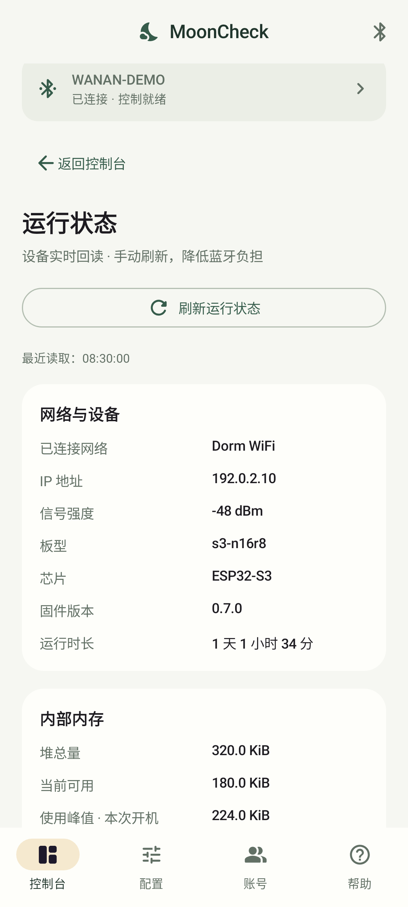
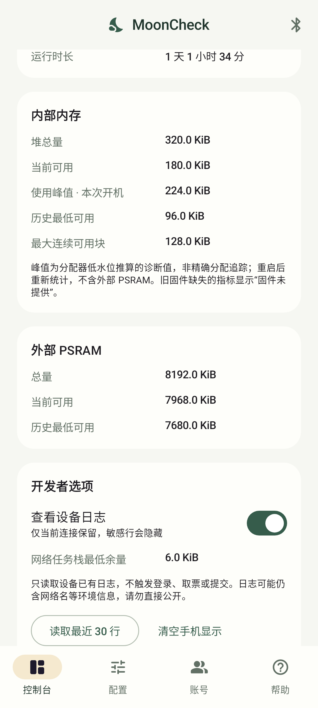

# v0.8.0 发行验收更新

2026-10-29 用户确认“基本功能已查验无误”，授权 Latest。自动检查、完整构建和发行清单证据见 [项目检查](../../docs/project-health.md)。APK versionName 0.8.0 / versionCode 800，仍为原 Debug 签名。用户未提供逐板型、手机、扫码闭环和长期压力明细；四实验目标未经实机验证。旧开发阶段记录以下保留，不作为当前验收的否定或扩大。

---

# 内置扫码开发版验证补充

用户确认原电脑端 / 手机端 BLE 中控功能均通过验收；该确认不包含下述新增扫码功能，且未提供逐设备环境。

新增扫码代码完成 46 项 Android 单元测试、lint、应用 APK 与设备端测试 APK 构建；另有电脑工具 35 项测试通过。已直接访问公开二维码页、解码 JPEG，并收到匿名轮询等待状态 408。真实本人确认授权后三 Cookie 回填与 BLE 保存仍待实测；设备端测试 APK 仅构建。完整实现、隐私和复验记录见[扫码授权说明](../../dev/docs/qr-authorization.md)。

开发 APK 沿用当前版本和 Debug 签名供验证，尚未发布或替换任何 GitHub 资产。下方为已发布版本的历史记录。

---

> 发行验收更新：2026-10-27 用户确认修正版“实测可行”并授权发行；未指明本次具体板型、手机或逐项测试环境，不据此声称两个原有目标均逐板验证。新增四种板型仍未经实际验证。

# v0.7.0 验证范围（2026-10-27）

本版共 42 项本地测试通过（另有三个固件生产组包 host 案例通过），lint 无问题；新增运行状态解析、旧固件降级、日志隐私与容量边界、断线清理及运行状态/开发者选项界面测试。自动验证汇总见[项目体检](../../docs/project-health.md)。自动检查未连接真实手机，随后用户已确认修正版实测可行；维护者仅能实测 S3-N16R8 / WROOM-32，其他型号未经实际验证，欢迎提交[验证反馈](../../docs/board-support.md)。

新增页面示意图（虚构状态）：





2026-10-27 修复：固件状态嵌入 JSON 的序列化覆盖前缀，导致旧 v0.7.0 回执无效。更新固件即可，APK 运行代码未改变；新增测试使用固件生产组包函数生成的回执，验证小 MTU 分片及握手成功。

以下为历史版本记录，不能用作 v0.7.0 联调通过证明。

# Android 实现与验证记录

> 当前状态：2026-10-26 用户确认 v0.6.0 APK 实际联调通过、功能全部正常，现为正式 Latest；环境细节未提供。以下“未实测”等内容仅属于初版历史记录。

> 本文保留 Android 0.1.0 初始开发记录及当时 APK 的摘要。v0.6.0 发行检查、更新后的测试数与资产以[项目体检](../../docs/project-health.md)和发行包清单为准。

验证日期：2026-10-26。应用版本：0.1.0，versionCode 1，包名 `io.mooncheck.app`。

## 实际交付

- Kotlin / Jetpack Compose 工程与 Gradle Wrapper。
- 四个主要入口：控制台、配置、账号、帮助；支持系统深浅色主题。
- 设备扫描与人工选板、服务发现、MTU 校验、通知订阅、握手、串行写入和按 ID 匹配业务回执。
- WiFi、单人账号、浏览器指纹、微信授权、坐标、时间、自动开关的表单控制。
- 多人账号增删启停、槽位显示、授权导入、演练与间隔设置。
- 默认及附加通知配置、通道状态与启停、关联修改、测试与删除。
- 体检、网络检查、微信取票与链路测试、最近活动、重置确认。
- 12 篇可离线搜索的内置帮助，包含首次使用、连接、授权、坐标、多人、通知、超时及隐私说明。
- 开发测试 APK：仓库根目录 `release/v0.1.0/MoonCheck-0.1.0-debug.apk`，17,466,449 字节。

APK SHA-256：

```text
7bb4cc94b470e0d44871c1fcb404748ac0b54a32e5b94db54aff25a0a8e6c1e7
```

APK 是 Debug 签名版本；未创建正式发行密钥、未发布到应用市场，未执行设备刷写。

## 已执行的验证

通过 `android/build-local.ps1` 完成以下任务：

| 检查 | 结果 |
| --- | --- |
| `testDebugUnitTest` | 31 项全部通过，0 失败 |
| 协议编解码测试 | 12 项：UTF-8 跨片、base64、长度边界、缺片/重复/冲突、旧字符串片与未知字段等 |
| 请求与状态测试 | 7 项：握手、账号槽位、超时不重放、ID 隔离、部分写入失败、并发阻止、长命令能力兼容 |
| 表单测试 | 6 项：空密码网络、空格、坐标、时间、通知关闭、YES 确认、槽位与到期时间 |
| 本地界面测试 | 6 项：离线首页、已配置示例、配置校验、账号说明、帮助搜索、真实提交确认 |
| `lintDebug` | `No issues found.` |
| `assembleDebug` | 生成 APK |
| `assembleDebugAndroidTest` | 生成设备端 UI 测试 APK；仅编译，未在设备运行 |
| `apksigner verify --verbose` | APK 签名校验通过，v2 签名 |
| `aapt dump badging` | minSdk 26、targetSdk 35、版本及包名与工程一致 |
| `git diff --check` | 通过 |

本机构建环境无法正常启动软件模拟器；没有更改 Windows 虚拟化设置，也没有操作已有用户模拟器。改用 Robolectric Android 35 原生图形模式直接绘制 Android View，生成生产 Compose 界面的截图，并逐张检查首页、配置、账号与帮助的中文显示、间距、导航和可滚动布局。截图包含虚构状态，**不代表已连接真实 BLE 设备**。

- [未连接首页](screenshots/01-dashboard-offline.png)
- [已配置示例首页](screenshots/02-dashboard-demo.png)
- [配置向导](screenshots/03-configuration.png)
- [账号页](screenshots/04-accounts.png)
- [离线帮助](screenshots/05-help.png)

## 为长凭据修复的固件兼容问题

代码审阅确认，原 `BleService` 接收缓冲为 4096 字节，但 `CommandRouter::WorkItem.payload` 只有 512 字节，`enqueue` 会静默截断较长的 JSON。BLE 分包本身不能绕过该限制。

本次最小修复：普通任务继续使用定长 payload；完整 BLE 命令改为最多 4095 字节的独立堆缓冲，由队列传递所有权，入队失败自动释放，执行后自动释放；`hello` 新增 `maxCommandBytes:4095`。不把整个 8 项队列固定扩成大缓冲，避免所有任务持续额外占用大量 RAM。

Android 读取该能力；没有字段的旧固件按 511 字节上限，在发送前阻止过长配置。旧固件的基本短命令仍可使用。若微信授权超出旧上限，请按固件 README 编译并刷入本次修复后的固件。没有自动刷写或 OTA。

实际执行 `platformio run -e esp32-s3-devkitc-1 -e esp32-wroom-32`，两种目标均编译成功；未做刷板、堆分配故障注入或真实长凭据导入测试。

## 尚未完成的发布验收

- 未用实际安卓手机连接任一 ESP32，MTU、权限撤销、跨厂商稳定性与后台恢复需要真机验证。
- 未在设备运行 `connectedDebugAndroidTest`，本地 JVM 界面测试不替代设备端验证。
- 未执行真实账号登录、授权导入、通知发送或打卡提交。
- 未完成 minSdk 26 至不同 Android 版本的真机兼容矩阵，深色主题和大字体仍需人工设备验收。
- 未完成正式签名、安装升级验证、应用市场分发与发布前 BLE 配对/加密或设备鉴权改造。当前固件的链路保护限制仍存在。
- 长报文下行外壳没有消息组 ID；交错组冲突会按失败处理，未修改固件的整组发送互斥策略。

结论：当前是完成实现、构建及本地验证的 **开发测试版**，适合进入真实手机与开发板联调，不能将其描述为已经过完整生产验收的正式发行版。

扫码回跳修复补充：Android 47 项测试、lint 和应用 / 设备测试 APK 构建通过；302 响应已有三个有效 Cookie 时在回调内结束，不访问外部完成页。缺字段仍保留跳转限制。完整本人扫码闭环待重试验证，详见[扫码故障记录](../../dev/docs/qr-authorization.md)。

账号独立位置补充：Android 与电脑 BLE 表单已对齐固件 account.add 的 lat / lng / addr 字段。覆盖指定位置、全部留空沿用设备位置、仅地址、成对校验、非有限 / 越界 / 零坐标拒绝及地址空格保留；本轮 Android 49 项、工具 40 项测试通过。未修改固件，也未连接真实设备提交账号。

## 四栏目与安全账号适配（2026-10-29，未发行）

本轮结论以 [完整实施验收记录](../../dev/docs/ble-console-redesign-verification.md) 为准。新增账号契约测试后 55 项 JVM 测试通过，lint / 两种 APK 构建通过；电脑控制台 52 项、独立桌面 55 项通过，六板型编译与产物验证通过。设备端测试、真实扫码、账号执行与新增固件 BLE 联调未执行，不能沿用用户对旧版本的验收。上面的 49 项及整条覆盖位置语义属于先前阶段；当前新界面修改已有账号改为非空字段合并，需匹配 account-v2 固件。
