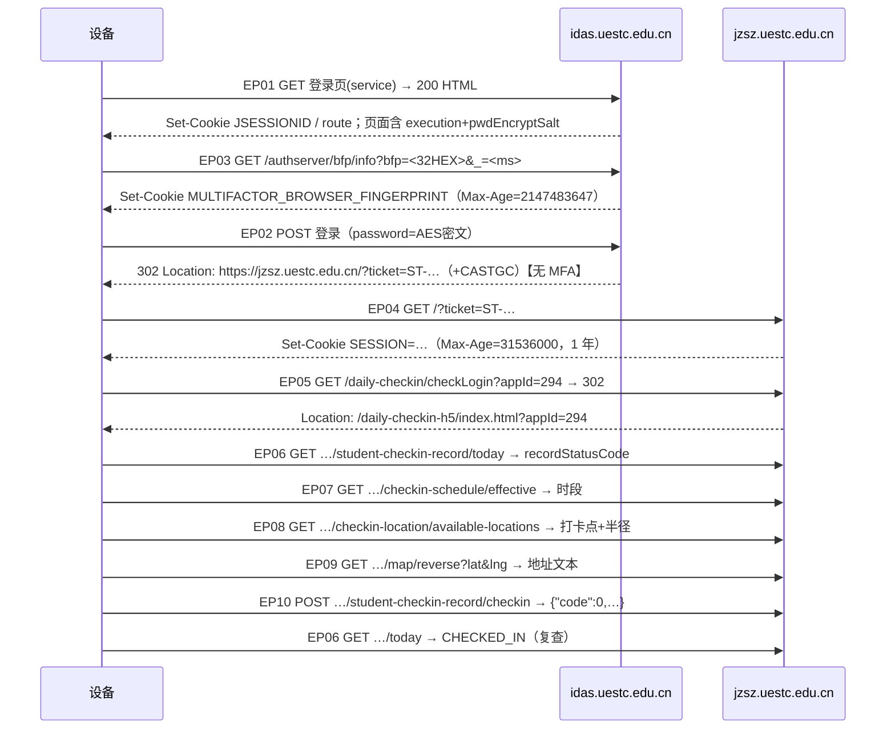

# 接口契约（API Contract）· v1.2

> **本文件 §0–§10 是 2026-10-11 至 2026-10-13 的历史抓包契约，不再单独代表当前完整打卡协议。**
> 当时的接口与时序来自 `capture/raw/burp-items.xml` 等真实抓包；2026-10-23 起平台要求打卡请求携带微信小程序签发的 `X-Checkin-Ticket`。当前固件实现补充见下方说明；新行为应以当前固件源码及用户指令手册为准。

### 当前固件补充：微信操作票据

当前打卡流程在提交请求前检查是否已有属于当前账号的有效票据；没有时，固件使用该账号槽位中的微信授权凭据现场申请票据。实现过程包括刷新凭据（需要时）、获取 `login_buffer`、通过 MMTLS 获取小程序登录码、校验绑定并申请操作票据。提交请求会带上 `X-Checkin-Ticket`。旧流程中仍有效的 CAS 登录、门户预热、H5 和业务接口步骤不因此取消。

| 项目 | 当前固件行为 |
| --- | --- |
| 票据申请接口 | `POST /platform-app/api/auth/checkin-ticket` |
| 打卡请求 | 在打卡请求中附加 `X-Checkin-Ticket` |
| 持久化 | 微信凭据保存在 NVS；服务端轮换后保存新凭据 |
| BLE 操作 | `wx.import` 导入、`wx.status` 查看脱敏摘要、`wx.test` 测试换票（不提交打卡） |
| 槽位 | 账号表为空时主账号使用槽位 0；多人时按账号表顺序 0–5 |
| 旧预编译包 | Releases 的 v0.4.0 固件不包含此能力；固件版本字符串暂未更新 |

`wx.import` 所需初始微信授权凭据的获取流程不在本仓库内。不要把 `wx.test` 与 `chain` 混为一谈：前者验证微信票据链，后者验证 CAS / 微应用链路。

---

## 0. 元信息

| 项 | 值 |
| --- | --- |
| 契约版本 | **v1.2（已填充，基于实测；§8.6 为 2026-10-13 补验）** |
| 抓包日期 | 2026-10-11 21:25 – 22:21 |
| 抓包工具 | Burp Suite Community + Edge/Chrome DevTools |
| 原始文件 | `capture/raw/burp-items.xml`（823 条）、各阶段关键请求 |
| 浏览器 User-Agent（**设备必须逐字固定**） | `Mozilla/5.0 (Windows NT 10.0; Win64; x64) AppleWebKit/537.36 (KHTML, like Gecko) Chrome/155.0.0.0 Safari/537.36` |
| 抓包网络 | 校园网环境（宿舍） |
| 本次登录是否要求二次验证 | 抓包时：**否**；V3 实测：**由 `MULTIFACTOR_BROWSER_FINGERPRINT` 决定**（可信 → 免验证；随机 → 要求验证），见 §8.3 |
| 打卡时间窗 | **21:00 – 23:30**（由 EP07 实测得 `1260 / 1410` 分钟偏移，与你口述一致） |
| 坐标系 | `gcj02` |
| 是否检出 JS 签名 | **否** ✅（R1 解除） |
| 微应用域名 | 与主站**同域** `jzsz.uestc.edu.cn`（不是独立域名） |
| 微应用启动方式 | 新标签页打开 `/daily-checkin-h5/index.html?appId=294`，**无一次性凭据** |
| 设备需要携带 Cookie 的域 | **2 个**：`idas.uestc.edu.cn`（登录用）+ `jzsz.uestc.edu.cn`（打卡用） |

---

## 1. 链路总览（实测时序）



---

## 2. 接口清单

| ID | 方法 | 路径 | 实测状态 | 鉴权 | 签名 | 必需自定义头 |
| --- | --- | --- | --- | --- | --- | --- |
| EP01 | GET | `https://idas.uestc.edu.cn/authserver/login?service=https%3A%2F%2Fjzsz.uestc.edu.cn%2F` | 200 | 无 | 无 | — |
| EP02 | POST | 同上 | **302** | 无 | 无 | `Content-Type: application/x-www-form-urlencoded` |
| EP03 | GET | `https://idas.uestc.edu.cn/authserver/bfp/info?bfp=<32HEX>&_=<ms>` | 200 | 无 | 无 | `X-Requested-With: XMLHttpRequest` |
| EP04 | GET | `https://jzsz.uestc.edu.cn/?ticket=ST-…` | 302→200 | 票据 | 无 | — |
| EP05 | GET | `https://jzsz.uestc.edu.cn/daily-checkin/checkLogin?appId=294` | **302** | SESSION | 无 | — |
| EP06 | GET | `/daily-checkin/api/student-checkin-record/today` | 200 | SESSION | 无 | `Platform: h5` + `Referer` |
| EP07 | GET | `/daily-checkin/api/checkin-schedule/effective` | 200 | SESSION | 无 | 同上 |
| EP08 | GET | `/daily-checkin/api/checkin-location/available-locations` | 200 | SESSION | 无 | 同上 |
| EP09 | GET | `/daily-checkin/api/map/reverse?lat=<..>&lng=<..>` | 200 | SESSION | 无 | 同上 |
| EP10 | POST | `/daily-checkin/api/student-checkin-record/checkin` | **200** | SESSION | **无** | `Content-Type: application/json` + `Platform: h5` + `Origin` + `Referer` |

统一常量：
- `Referer`（EP06–EP10）= `https://jzsz.uestc.edu.cn/daily-checkin-h5/index.html?appId=294`
- `Origin`（EP10）= `https://jzsz.uestc.edu.cn`
- `appId` = `294`

---

## 3. 逐接口详情

### EP01 · 取登录页

| 项 | 值 |
| --- | --- |
| 响应 | HTML |
| 提取 `execution` | 正则 `name="execution"\s+value="([^"]+)"` → 实测 `e1s1` |
| 提取 `pwdEncryptSalt` | 正则 `id="pwdEncryptSalt"\s+value="([^"]+)"` → 实测 16 字符，**每次加载变化** |
| 下发 Cookie | `JSESSIONID`（`Path=/authserver; HttpOnly`）、`route`（`Path=/authserver`） |
| 注意 | 页面存在多个表单，`pwdEncryptSalt` 值相同；`cllt=userNameLogin` 对应账号密码登录 |

### EP02 · 提交登录

| 项 | 值 |
| --- | --- |
| `Content-Type` | `application/x-www-form-urlencoded` |
| 请求体字段 | `username`、`password`（加密）、`captcha`（空）、`_eventId=submit`、`cllt=userNameLogin`、`dllt=generalLogin`、`lt`（空）、`execution` |
| 成功判定 | **302** 且 `Location` 含 `ticket=ST-` |
| 失败判定 | 200 + HTML（含错误提示）/ 200 + 多因素页面（`isMultifactor`/`authLogin`） |
| 响应 `Set-Cookie` | `happyVoyage`（`Path=/; HttpOnly`，会话级）、`CASTGC`（`Path=/authserver; HttpOnly`，会话级）、`platformMultilingual=zh_CN; Domain=edu.cn` |
| 备注 | `happyVoyage` 由本响应下发，本次流程未发现后续请求依赖它（见 §9 待确认） |

### EP03 · 浏览器指纹上报

| 项 | 值 |
| --- | --- |
| Query | `bfp=<32 位大写 HEX>`、`_=<毫秒时间戳>` |
| 响应 `Set-Cookie` | `MULTIFACTOR_BROWSER_FINGERPRINT=<同一个值>; Max-Age=2147483647; Expires=Fri, 29 Oct 2094; Path=/; HttpOnly` |
| 机制推断 | 服务端把 `(账号, 指纹值)` 记为可信设备；免二次验证据此判定（**待 §8 实验确认**） |
| 设备用法 | **固定使用抓包中的指纹值**（直接注入 Cookie 亦可，等价） |

### EP04 · 票据换会话

| 项 | 值 |
| --- | --- |
| 请求 | `GET https://jzsz.uestc.edu.cn/?ticket=ST-…` |
| 响应 `Set-Cookie` | **`SESSION=<UUID>; Max-Age=31536000; Expires=<一年后>; Path=/; HttpOnly`** ← 打卡鉴权唯一凭据 |
| 设备用法 | 保存 `SESSION` 到 NVS；平时直接复用，失效才重新登录 |

### EP05 · 进入微应用

| 项 | 值 |
| --- | --- |
| 响应 | `302 Location: /daily-checkin-h5/index.html?appId=294` |
| `Set-Cookie` | 无 |
| 结论 | **无需复现前端**，直接调用 EP06–EP10 即可；EP05 可选（本轮实测中调用它与不调用均有成功记录） |

### EP06 · 今日状态（幂等判断依据）

| 项 | 值 |
| --- | --- |
| 响应体 | `{"code":0,"msg":"操作成功","data":{…},"ok":true}` |
| 关键字段 | 见下表 |
| ⚠️隐私 | `data` 内含**本人姓名/学号/手机号**及**辅导员姓名与手机号**；固件与脚本**只允许解析下表字段**，禁止整包落盘或打印 |

| 字段 | 未打卡 | 已打卡 |
| --- | --- | --- |
| `recordStatusCode` | `PENDING` | `CHECKED_IN` |
| `checkinTime` | `null` | `"2026-10-11 22:05:06"` |
| `distanceMeter` | `null` | `68.70` |
| `abnormalFlag` | `false` | `false`（异常时 `true`，**必须检查**） |
| `businessDate` | `"2026-10-11"` | 同 |
| `checkinLocationName` | `"本科3组团"` | 同 |
| `checkinLocationLatitude` / `Longitude` | `30.7549800` / `103.9338830` | 同 |
| `checkinRadiusMeter` | `130` | 同 |

### EP07 · 有效时段

```json
{"code":0,"msg":"操作成功","data":{
  "scheduleName":"默认签到时段",
  "studentCheckinStartOffsetMinute":1260,
  "studentCheckinEndOffsetMinute":1410,
  "studentReportStartOffsetMinute":1260,
  "studentReportEndOffsetMinute":2760,
  "effective":true},"ok":true}
```

| 字段 | 含义 |
| --- | --- |
| `studentCheckin*OffsetMinute` | **打卡窗口**，自 00:00 起分钟数 → 1260 = **21:00**，1410 = **23:30** |
| `studentReport*OffsetMinute` | 上报/异常处理窗口（1260–2760，即 46 小时） |

> **设备应动态读取本接口**决定打卡时间，勿硬编码；固件默认 22:00 仍在其内。

### EP08 · 可用打卡点

```json
{"code":0,"msg":"操作成功","data":[{
  "id":"4","locationName":"本科3组团","address":"",
  "longitude":103.9338830,"latitude":30.7549800,"radiusMeter":130,
  "groupId":"4","groupName":"本科3组团"}],"ok":true}
```

| 结论 | 值 |
| --- | --- |
| 打卡点中心 | `lat 30.7549800, lng 103.9338830` |
| 允许半径 | **130 m** |
| 示例坐标（本仓库统一取值） | `lat 30.7549800, lng 103.9338830`（＝打卡点中心，距中心 **0 m**，天然在范围内 ✅） |

> 设备固定坐标二选一：**① 你自己宿舍的实测坐标（推荐，真实）**；② 打卡点中心（距离 0 m，兜底，也是本仓库所有示例与默认值的取值）。
> 两者都应在固件中可配置（BLE `loc.set`）。
>
> 🔒 **隐私提示**：作者本人宿舍的实测坐标距中心 **68.70 m**（已实测打卡成功），但**不写入本仓库**——精度约 0.1 m，属于个人信息。
> 你复刻时同理：请勿把**你自己**宿舍的坐标写进任何文档、示例或默认值，用 `loc.set` 配置到设备里即可。

### EP09 · 逆地理编码

`GET /daily-checkin/api/map/reverse?lat=<lat>&lng=<lng>` → 返回地址文本（示例值 `四川省成都市郫都区`；实际文本由接口按坐标返回）。
**非必需**：设备可直接使用固定地址文本，节省一次请求。

### EP10 · 提交打卡

| 项 | 值 |
| --- | --- |
| `Content-Type` | `application/json` |
| 请求体 | 见 §7 模板（447 字节） |
| 成功响应 | `{"code":0,"msg":"操作成功","data":true,"ok":true}` |
| 无签名 | ✅ **无 `sign`/`nonce`/`appId` 等签名字段，无 CSRF token** |
| 幂等 | 服务端按 `businessDate` 去重；同一天重复提交的返回值待观察（设备侧必须先查 EP06） |

---

## 4. 常量表（固件硬编码/配置来源）

| 名称 | 值 |
| --- | --- |
| CAS `service` | `https%3A%2F%2Fjzsz.uestc.edu.cn%2F` |
| 表单 `_eventId` / `cllt` / `dllt` | `submit` / `userNameLogin` / `generalLogin` |
| 固定 User-Agent | 见 §0（**逐字复制，不可改**） |
| `appId` | `294` |
| H5 `Referer` | `https://jzsz.uestc.edu.cn/daily-checkin-h5/index.html?appId=294` |
| 打卡坐标（示例/默认） | `lat 30.7549800, lng 103.9338830`（打卡点中心，距离 0 m） |
| 打卡点中心 | `lat 30.7549800, lng 103.9338830`，半径 `130 m` |
| 打卡窗口 | `21:00 – 23:30`（动态读取 EP07） |
| 时区 | `CST-8` |
| 地址文本 | `四川省成都市郫都区`（示例值，可用 EP09 按坐标刷新） |

---

## 5. Cookie 规则（固件 Cookie 罐实现依据）

| 名称 | 域 | Path | 有效期 | 设备是否需要 | 说明 |
| --- | --- | --- | --- | --- | --- |
| `JSESSIONID` | idas | `/authserver` | 会话级 | ✅ 登录流程内 | 登录页 → POST 必须同一会话 |
| `route` | idas | `/authserver` | 会话级 | 建议保留 | 负载均衡粘滞 |
| `MULTIFACTOR_BROWSER_FINGERPRINT` | idas | `/` | **Max-Age=2147483647（2094）** | ✅ **免二次验证核心** | 值 = 上报的 32 位 HEX |
| `CASTGC` | idas | `/authserver` | 会话级 | 可忽略 | SSO 票据 |
| `happyVoyage` | idas | `/` | 会话级 | 观察 | 登录 POST 响应下发 |
| `platformMultilingual` | `.edu.cn` | `/` | — | 可忽略 | 语言 |
| **`SESSION`** | jzsz | `/` | **Max-Age=31536000（1 年）** | ✅ **打卡鉴权唯一凭据** | UUID 格式 |

---

## 6. 密码加密算法（固件 `cas_auth` 实现依据）

```js
// 来源：https://idas.uestc.edu.cn/authserver/uestcTheme/static/common/encrypt.js
function getAesString(data, key, iv) {
  key = CryptoJS.enc.Utf8.parse(key); iv = CryptoJS.enc.Utf8.parse(iv);
  return CryptoJS.AES.encrypt(data, key, {iv: iv, mode: CBC, padding: Pkcs7}).toString();
}
function encryptAES(data, key) { return key ? getAesString(randomString(64) + data, key, randomString(16)) : data; }
function encryptPassword(data, key) { try { return encryptAES(data, key); } catch (e) {} return data; }
var $aes_chars = "ABCDEFGHJKMNPQRSTWXYZabcdefhijkmnprstwxyz2345678";
```

| 参数 | 值 | 固件实现 |
| --- | --- | --- |
| key | `pwdEncryptSalt`（16 字符，UTF-8 直接作 16 字节） | mbedTLS `mbedtls_aes_setkey_enc` 128-bit |
| iv | `randomString(16)`（**不发送**） | 取随机 16 字符即可，服务端不依赖它 |
| 明文 | `randomString(64) + 密码` | 前置 64 字节随机串（4 个分组）是关键 |
| 模式/填充 | AES-128-CBC / PKCS7 | `MBEDTLS_MODE_CBC` + 手写 PKCS7 |
| 提交值 | `base64(密文)`，**不含 IV** | 108 字符（11 位密码时 = 80 字节） |
| 随机字符集 | `ABCDEFGHJKMNPQRSTWXYZabcdefhijkmnprstwxyz2345678` | 复用同一字符集最稳 |

> **为什么 IV 不重要**：明文前 64 字节是随机串，密码总落在第 5 个分组之后；CBC 从第 2 个分组起与 IV 无关，故服务端用任意 IV 都能取出密码。此为金智实现的已知特征，已用抓包密文实测验证。

---

## 7. 打卡载荷模板（**字段结构**实测原样；坐标/地址/时间为示例值）

```json
{"latitude":30.7549800,
 "longitude":103.9338830,
 "reverseGeocode":"四川省成都市郫都区",
 "clientTime":"2026-10-11 22:05:05",
 "userAgent":"Mozilla/5.0 (Windows NT 10.0; Win64; x64) AppleWebKit/537.36 (KHTML, like Gecko) Chrome/155.0.0.0 Safari/537.36",
 "coordinateSystemCode":"gcj02",
 "accuracy":86,
 "locationDurationMs":1189,
 "networkTypeCode":"4g",
 "locationEnabled":false,
 "locationAuthorized":"",
 "locationAccuracy":"",
 "errorMessage":""}
```

| 字段 | 设备侧取值 |
| --- | --- |
| `latitude` / `longitude` | 配置的固定坐标（BLE `loc.set`） |
| `reverseGeocode` | 固定地址文本（或调 EP09） |
| `clientTime` | 设备本地时间 `YYYY-MM-DD HH:mm:ss`（SNTP 校准） |
| `userAgent` | 与登录 UA **完全一致** |
| `coordinateSystemCode` | `gcj02`（不可改） |
| `accuracy` | 固定 `86`（实测值；无证据表明服务端校验） |
| `locationDurationMs` | 固定 `1189` |
| `networkTypeCode` | 固定 `4g` |
| 其余三个空串 + `locationEnabled:false` | 原样保留（**不做字段裁剪**，避免被判异常） |

---

## 8. 判定实验结论

### 8.1 已确认

| 项 | 结论 |
| --- | --- |
| 打卡接口可脚本化（R1） | ✅ **无签名、无 token、无验证码** |
| 微应用跨域/一次性凭据（R12） | ✅ **不存在**：同域，新标签页，无 token |
| 打卡窗口 | ✅ 21:00–23:30（EP07 实测） |
| 打卡点与半径 | ✅ 本科3组团中心 + 130 m |
| 会话有效期 | ✅ Cookie 层 1 年（**服务端真实 TTL 待 V4 实测**） |
| 密码算法 | ✅ 已解出并可由脚本复现 |

### 8.2 实测验证结果（PC 端 Python，2026-10-11）

| 编号 | 待确认 | 结果 |
| --- | --- | --- |
| V1 | 脚本提交打卡能否成功 | ✅ **通过**：注入 `SESSION` 后 `today` / `schedule` / `available-locations` 全部 200，字段与抓包一致 |
| V2 | 脱离浏览器登录能否成功 | ✅ **通过**：全新会话（无 `CASTGC`、无 `happyVoyage`、无 JS 指纹）→ 登录页取 salt → POST 登录 → **302 带票据** → 换到新 `SESSION` → **用新会话查询打卡状态成功** |
| V3 | 免二次验证的条件 | ✅ **定论：由 `MULTIFACTOR_BROWSER_FINGERPRINT` 决定**（见 §8.3） |
| V4 | `SESSION` 真实寿命 | ☐ 待连续多日 `probe-session` |
| V5 | 连续挂机成功率 | 🟡 命令冒烟通过；真实打卡待窗口内执行 |

### 8.3 免二次验证机制的实测判定（V3）

同一账号、同一网络、同一 User-Agent，**只改变指纹 Cookie**，各登录一次：

| 实验 | 指纹处理 | 登录 POST 响应 | 结论 |
| --- | --- | --- | --- |
| V2 | 注入抓包中的可信指纹（`0927…`） | **302 → `https://jzsz.uestc.edu.cn/?ticket=ST-…`** | **免二次验证** ✅ |
| V3b | 上报全新随机指纹 | **302 → `/authserver/reAuthCheck/reAuthLoginView.do?isMultifactor=true&service=…`** | **要求二次验证** ⚠️ |
| V3c | 不上报指纹 | （未做，价值低：结果与 V3b 同类） | — |

**结论（固件实现依据）**：

1. 免二次验证**不依赖**浏览器、不依赖 UA、不依赖 IP、不依赖本地 Cookie 存储机制——**只取决于服务端是否把该指纹值记为可信**；
2. 因此设备只需**逐字固定使用抓包中的指纹值**（`config.browser_fingerprint`），即可长期免验证；
3. 设备**无需调用 EP03**（`bfp/info`），直接注入 Cookie 即可（V2 已实测）；
4. `happyVoyage` **不是登录必需**（V2 的全新会话中并不存在该 Cookie，登录依然成功）——R2 反爬风险在登录环节基本排除；
5. 兜底（F2）：若服务端将来清除该指纹的信任，设备会拿到 `reAuthLoginView.do?isMultifactor=true` 的 302 → 此时必须走"验证码中继"。该页面的验证码交互细节**需要一次浏览器抓取**（脚本直接 GET 会退回登录页，见 §9）。

### 8.4 微应用访问权与"会话建立时间"（重要发现，2026-10-12 实测）

> ⚠️ **2026-10-13 深夜更正**：本节与 §8.5 关于"会话建立时间/窗口"的解释**已被 §8.7 推翻**。
> 真正原因是登录后缺少一次**门户预热** `GET /api/isLoginFailure`；打卡窗口只决定"能否提交打卡"，与授权无关。
> 下面的记录保留作为排查过程的历史。

| 会话建立时间 | 客户端 | `GET /daily-checkin/checkLogin?appId=294` | `GET …/student-checkin-record/today` |
| --- | --- | --- | --- |
| **21:30（窗口内）** | 浏览器 | ✅ 302 → `/daily-checkin-h5/index.html?appId=294` | ✅ `code=0` |
| **22:20（窗口内）** | Python 脚本 | ✅ 同上 | ✅ `code=0` |
| **03:34 / 03:45（窗口外）** | 固件 / Python 脚本 | ❌ 302 → `https://jzsz.uestc.edu.cn/`（退回首页） | ❌ `code=4001 登录无效或已过期` |
| 03:45（窗口外），**沿用 21:30 建立的会话** | Python（极简头）/ 浏览器 | ✅ 进入 H5 页 | ✅ `code=0`，`recordStatusCode=PENDING` |

**结论**

1. 平台**只给"在打卡时段（21:00–23:30）内建立的会话"授予微应用访问权**；
2. 窗口外建立的会话：CAS 登录成功、1 年期 `SESSION` 正常下发、平台首页 `GET /` 也返回 200（看起来"已登录"），但**微应用一律拒绝** —— `checkLogin` 被 302 退回首页、业务接口统一回 `4001 登录无效或已过期`（措辞具有误导性）；
3. 窗口内建立的会话，**窗口外、跨天依然可用**（2026-10-12 凌晨仍能读到 10-12 的 `PENDING` 状态）；
4. **与请求头无关**：极简请求头与浏览器全套头（含 `Sec-Fetch-*` / `Sec-Ch-Ua*`）结果完全一致；
5. **对固件的硬约束（2026-10-13 深夜修订）**：授权与窗口无关，**前提是登录后做一次门户预热**（§8.7）；但 `SESSION` TTL 约 1 小时，所以登录仍应贴近打卡时间。因此预登录的判据就是**平台窗口本身**（固件已改为**窗口起点 21:00 触发一次**）：若发现会话失效，必须**当即在窗口内补登录**，不能拖到 22:00 之后；原来"比窗口起点提前 10 分钟也能登录"的宽限期已删除。

> 排查提示：遇到 `4001` 时，先确认这次会话是**什么时候建立的**，再去怀疑接口或签名。

### 8.5 修正：登录成功 ≠ 立即生效（2026-10-12 22:00 实测，推翻上面的部分表述）

用户在真实运行时跑出了这条链路（固件日志原文）：

| 时刻 | 动作 | 结果 |
| --- | --- | --- |
| 21:55:47 | **窗口内**登录成功，拿到新 `SESSION` | ✅ |
| 21:55:48 | 立刻 `checkLogin` 验证 | ❌ 302 → 平台首页（h5=0） |
| 22:00:12 | 又登录一次（同一天第二次） | ✅ 登录仍成功 |
| 22:00:20 | 立刻 `checkLogin` 验证 | ❌ 302 → 平台首页（h5=0） |
| **22:10:03** | 用**同一个**会话（22:00 那次建立的）再进微应用 | ✅ **302 → `/daily-checkin-h5/index.html`** |
| 22:10:05 | `today` | ✅ `code=0`，`PENDING` |
| 22:10:29 | `POST …/checkin` → 复查 `today` | ✅ `code=0`，`CHECKED_IN`（distance 68.7 m） |

**修正后的结论（这才是准确表述）**

1. **CAS 登录成功后，平台侧需要数分钟才放行微应用**——「登录成功但立刻验证失败」**不等于会话无效**，而是"尚未生效"；
2. 固件必须**在登录后稍后重试**，不能当场判定失败；
3. **短时间内重复登录毫无帮助**（22:00 那次重复登录是白烧一次登录次数）——固件已加入 **30 分钟登录冷却**；
4. **打卡必须带窗口内重试循环**（固件已实现：每 3 分钟重试至窗口结束）。本次正是因为缺少重试，22:00 失败后不再尝试，**整个窗口被浪费**，最终靠人工在 22:10 补打；
5. 对 §8.4 的再修正：凌晨 03:34 / 03:45 的窗口外登录，当时**只等了 0–2 秒**就验证，因此**不能断定"窗口外永不生效"**。目前可确证的是：**登录后都需要等待并重试**；窗口内实测约 10 分钟内生效。窗口外是否也能"等待生效"当时尚未验证（不影响固件设计——固件只在窗口内登录）。
   > ⚠️ **2026-10-13 深夜更正**：当时以为"窗口外建立的会话永不被授权"，实为**缺少门户预热**（见 §8.7） —— 本次实验同时确认了"能进界面 ≠ 能打卡"。

---

### 8.6 微应用授权 = 会话属性（2026-10-13 全天实验；结论已修订，**根因见 §8.7**）

`dev/tools/pc_reference/diag_entry.py` 的受控实验结果（**推翻 §8.5 第 5 条的"尚未验证"**）：

| 会话建立时机 | 请求方式 | `GET /daily-checkin/checkLogin?appId=294` | `GET …/student-checkin-record/today` |
| --- | --- | --- | --- |
| **窗口外（21:00 之前 / 23:30 之后）** | 极简请求头 | ❌ **302 → `https://jzsz.uestc.edu.cn/`**（退回平台首页） | ❌ `{"code":4001,"msg":"登录无效或已过期"}` |
| **窗口外** | 浏览器全套请求头（含 `Sec-Fetch-*` / `Sec-Ch-Ua*`） | ❌ 同上（结果完全一致） | ❌ 同上 |
| **窗口外** | 静态页 `GET /daily-checkin-h5/index.html?appId=294` | ✅ **200**（页面本身任何时机都可达） | — |

**结论（2026-10-13 晚间修订 —— 请以本段为准，上面那张表只是当日第一轮实验的记录）**

1. **授权是"服务端会话属性"，与请求头 / Referer / 客户端 IP 都无关**：把浏览器那条**已授权**会话拿到另一台机器，用**极简请求头**重放 → `checkLogin` 302 → H5、`today` **code=0**（实测通过）。
2. **重新建立的程序化会话一律拿不到授权**，窗口内也一样；连等 **14 分钟**每 30 s 轮询（`dev/tools/pc_reference/diag_activation.py`）始终是 302 → 首页 / `4001`。
3. **已排除的原因**（每项都有对照实验，勿重复试）：

   | 猜测 | 实验 | 结果 |
   | --- | --- | --- |
   | 窗口外才被拒 | 窗口内 21:2x 全新登录 | ❌ 同样被拒 |
   | 缺请求头 | 完整浏览器头（`Sec-Fetch-*` / `Sec-Ch-Ua*` / `Accept-Language`） | ❌ 与极简头结果一致 |
   | 缺门户来源页 | `Referer` = 平台首页 / H5 页（`diag_referer.py` V2–V4） | ❌ 均被拒 |
   | 缺指纹预登记 | 先补 `GET /authserver/bfp/info?bfp=…` 再登录（`diag_bfp.py`） | ❌ 仍被拒 |
   | 激活延迟（等一会儿就好） | 同一会话轮询 14 分钟（`diag_activation.py`） | ❌ 从未放行 |
   | 客户端网络 / IP | 设备与 PC 均在校园网；且授权会话可从别处重放成功 | ❌ 无关 |
   | 匿名 SESSION 覆盖登录态 | 设备日志显示票据校验未下发新 SESSION | ⚠️ **真 bug**（已修：登录前 `remove("SESSION")`），但不是授权被拒的原因 |

4. 浏览器侧实测（用户）：**全新登录后只能进平台首页**；**登录信息未过期时**直接输网址即可进打卡页 ⇒ 授权与"会话是怎么建立的"绑定，而不是与时间绑定。
5. **仍未定位的关键一步**：从平台首页点"晚安成电"图标进入时，是否有一个**先于 `checkLogin` 的请求或一次性凭据** —— 见 §9 第 8 项（当前最关键未决项）。
6. **对固件的现实影响**：设备自登录目前**无法获得可用会话**；当前可用路径是 `session.set` 注入"浏览器已授权会话"（实测：注入后 `checkLogin` → H5、`today` code=0、EP10 提交成功 `checkinTime=2026-10-13 21:36:01 / distanceMeter=68.7 / abnormalFlag=false`）。但 `SESSION` 的 TTL **约 1 小时**（浏览器 Cookie `Expires` 实测），该路径只能覆盖当次打卡，做不到无人值守。
7. **"能打开打卡界面" ≠ "能打卡"** 仍然成立：静态 H5 页任何会话都返回 200，只有 `checkLogin` 放行 + 业务接口 `code=0` 才算数（对应固件的 `h5Page` / `appEntry` 判据）。

---

### 8.7 ★ 根因定案：微应用授权的前提是"门户预热" `GET /api/isLoginFailure`

**结论**：CAS 登录成功换来的会话，**必须先被门户初始化一次**，微应用（晚安成电）才认它。判据只有一个请求：

```
GET https://jzsz.uestc.edu.cn/api/isLoginFailure?_t=<毫秒时间戳>
Accept: application/json, text/plain, */*
Content-Type: application/json;charset=UTF-8
Origin: https://jzsz.uestc.edu.cn
Referer: https://jzsz.uestc.edu.cn/
Sec-Fetch-Site: same-origin / Sec-Fetch-Mode: cors / Sec-Fetch-Dest: empty
→ 200，响应体仅 71 字节
```

**发现过程（2026-10-13 深夜，一次登录分层验证）**

| 步骤 | 做法 | `checkLogin` | `today` |
| --- | --- | --- | --- |
| 阶段0 | 全新登录后直接测（基线） | 302 → 平台首页 ❌ | `4001` |
| 阶段1 | 回放浏览器登录后发的 17 个门户 XHR（HAR 提取） | **302 → H5 ✅** | **code=0 ✅** |
| 二分 | 逐个候选接口单独调用 + 复测 | 第一个就中：**`/api/isLoginFailure`** | code=0 |

脚本与产物：`dev/tools/extract_portal_sequence.py` → `dev/tools/pc_reference/portal_sequence.json`；
`dev/tools/pc_reference/diag_portal_replay.py`（分层）、`dev/tools/pc_reference/diag_minimal_warmup.py`（二分）。

**为什么之前所有实验都失败**：我们只做了"登录 + 首页 GET"，而浏览器在登录后由页面 JS 立刻打了一串门户接口；
其中 `isLoginFailure` 会在服务端把该会话标记为"已初始化的登录态"，`daily-checkin` 服务读取这个标记，
没有标记就一律回 `4001 登录无效或已过期`（**措辞极具误导性**，与"过期"无关）。

**由此推翻的旧结论**：§8.5/§8.6 里"窗口外建立的会话不被授权""登录后需等约 10 分钟才放行"都是**误判**——
真实原因是当时没人做门户预热；窗口只决定**能否提交打卡**（EP07 的 21:00–23:30），与授权无关。

**固件实现**：`CheckinApi::warmUpPortal()`；调用点 = ① `ensureSession()` 登录成功后；② `probe()` 发现未授权时（自愈，
也顺带让 `session.set` 注入的会话立刻可用）；③ `test.chain` 的 3c 阶段（回执字段 `warmup` / `warmStatus`）。

---

## 9. 待确认项

| # | 事项 | 状态 / 影响 |
| --- | --- | --- |
| 1 | `happyVoyage` 是否被后续请求校验 | ✅ **已排除**：V2 全新会话无此 Cookie 也能登录 |
| 2 | 免二次验证的判定依据 | ✅ **已定论**：`MULTIFACTOR_BROWSER_FINGERPRINT`（§8.3） |
| 3 | `SESSION` 服务端真实 TTL | ☐ 决定设备登录频率（V4，需连续多日观察） |
| 4 | 同一天重复打卡的服务端行为 | ☐ 幂等策略（设备侧已先查 EP06 兜底） |
| 5 | 打卡载荷中 `accuracy` 等字段是否被校验 | ☐ 若校验则需真实值（当前直接复刻实测值） |
| 6 | 校园网接入方式（802.1X / Portal） | ☐ 见 `docs/network-uestc-wifi.md` |
| 7 | **MFA 验证码交互细节**（发送/校验接口、trust 参数） | ☐ 仅 F2 兜底需要；脚本化 GET `reAuthLoginView.do` 会退回登录页，**需一次浏览器抓取** |
| 8 | ~~浏览器点首页图标进微应用时是否有前置请求~~ | ✅ **已定案（§8.7）**：入口本身无前置请求，但**登录后必须门户预热** `GET /api/isLoginFailure` |
| 9 | `SESSION` TTL 是否滑动续期（实测约 1 小时） | ☐ 决定"注入会话"路径能否延长；影响预登录与打卡的时间差设计 |

---

## 10. 变更记录

| 版本 | 日期 | 变更 |
| --- | --- | --- |
| v0 | 2026-10-11 | 建立模板 |
| v0.2 | 2026-10-11 | 并入实测 E1/E2（MFA 非必经、微应用新窗口） |
| **v1.0** | 2026-10-11 | **基于真实抓包全量填充**：10 个端点、密码算法（源码+密文双重确认）、打卡载荷模板、Cookie 规则、130 m 半径、21:00–23:30 窗口；确认无签名、无跨域、无一次性凭据 |
| **v1.1** | 2026-10-11 | **PC 端实测结论并入**：V1/V2 通过（脚本可独立完成全链路）；V3 定论 —— 免二次验证由 `MULTIFACTOR_BROWSER_FINGERPRINT` 决定；`happyVoyage` 非必需；MFA 入口为 `/authserver/reAuthCheck/reAuthLoginView.do?isMultifactor=true` |
| **v1.2** | 2026-10-13 | **新增 §8.6**（PC 端受控实验：极简头/浏览器全套头均 302 退回首页 + `4001`）；明确 `h5Page` 判据；§8.4 硬约束改为**窗口起点 21:00 预登录**（原 21:50） |
| **v1.3** | 2026-10-13 | **§8.6 结论修订**：授权是**服务端会话属性**（已授权会话可在另一台机器以极简头重放成功）；**窗口内新会话同样被拒**（14 分钟轮询未放行）；排除"窗口/请求头/Referer/`bfp/info`/激活延迟/客户端网络"六项；补记 `SESSION` TTL≈1 h 与 `session.set` 注入路径的实测打卡成功（21:36:01 / 68.7 m）；新增 §9 第 8/9 项待确认 |
| **v1.4** | 2026-10-13 | **§8.7 根因定案**：微应用授权的前提是登录后一次门户预热 `GET /api/isLoginFailure`（71 B）；推翻 §8.5/§8.6 的"窗口/延迟"解释；固件新增 `CheckinApi::warmUpPortal()`（登录后 + probe 未授权时自愈 + `chain` 的 `warmup` 字段） |
