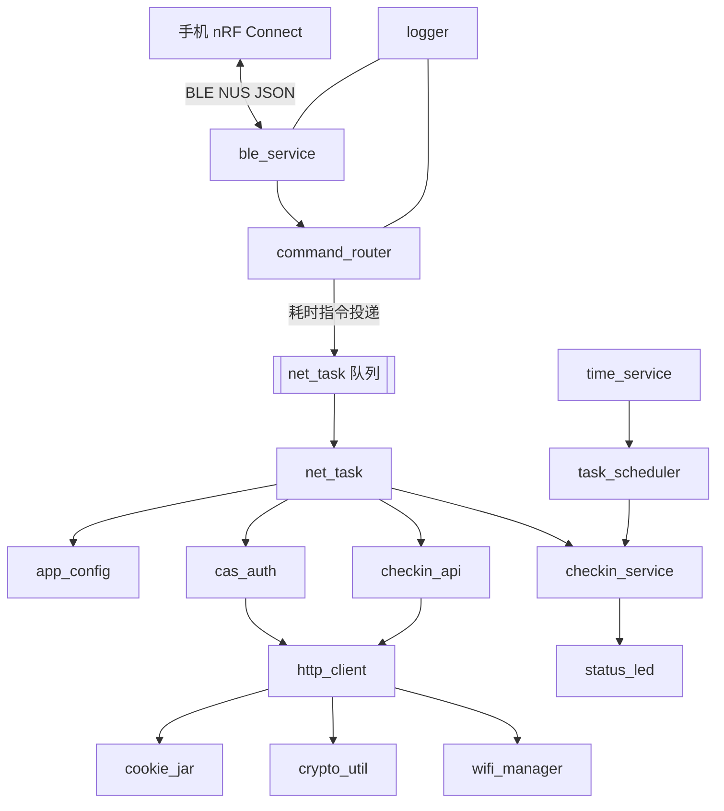
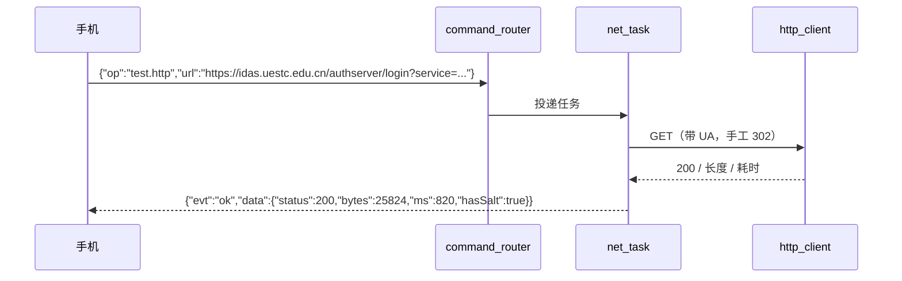
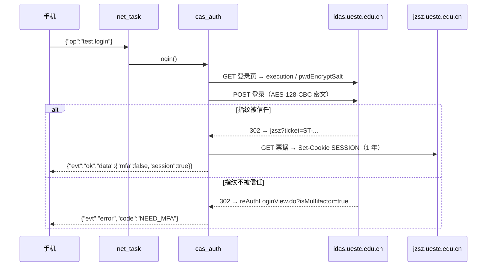
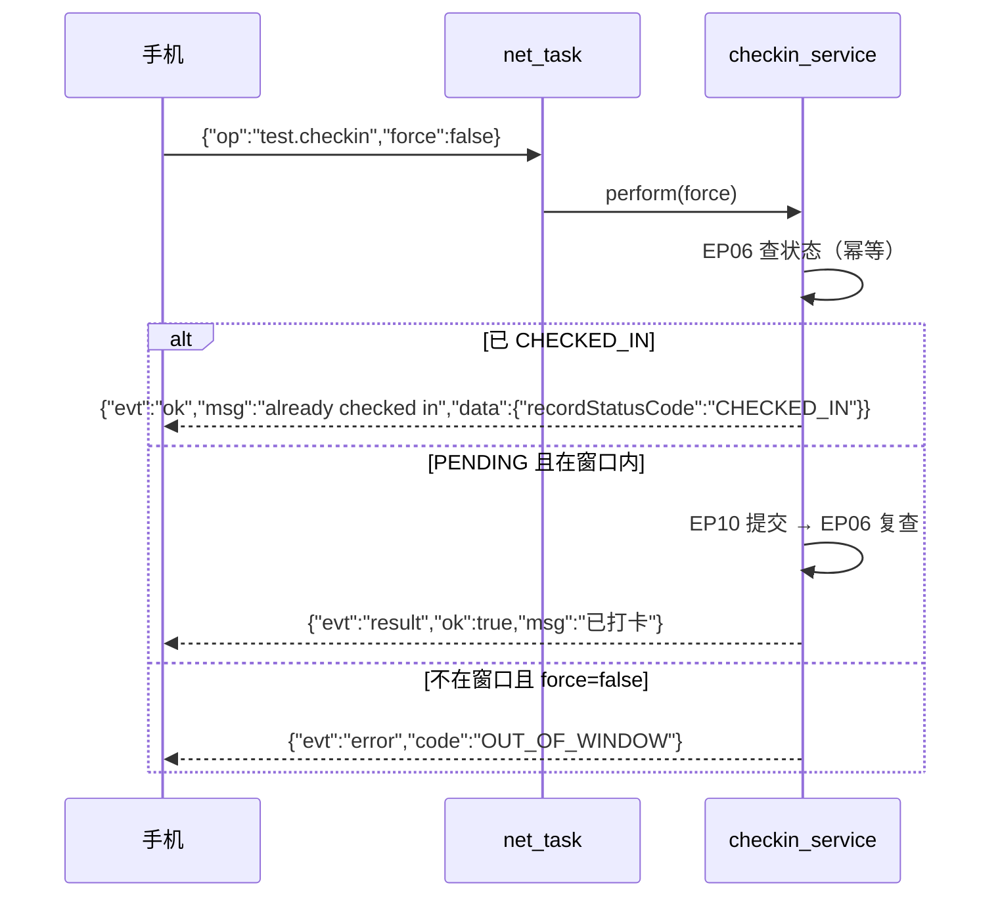
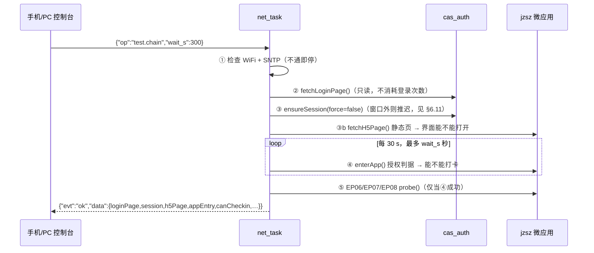

# 固件设计文档 · 基础功能阶段（ESP32-S3 / PlatformIO）

> 阶段目标：**打通"能上网、能被配置、能验证前置链路、能在正确时间打卡"**。
> 本文只描述**模块功能与接口**（不贴实现代码）；每个模块一对 `.h` / `.cpp`，与本文档第 §6 节一一对应。
> 上游依据：`docs/api-contract.md` v1.2（接口契约）、`docs/python-verification-plan.md`（已验证的链路与算法）。
> Python 参考实现 `dev/tools/pc_reference/` 已跑通全链路，**固件就是把它翻译成 C++**。

> **当前状态说明（2026-10-23 之后）：** 本文记录的是固件早期基础设计，不再完整描述当前实现。当前打卡除 CAS / 微应用会话外，还必须在提交前获取微信小程序操作票据，并在请求中携带 `X-Checkin-Ticket`。固件使用 `wx_oauth`、`wx_mmtls`、`wx_wire`、`wx_credential_store` 等模块完成授权和票据获取；入口及验证命令见[BLE 协议](ble-protocol.md)与[用户指令手册](../../docs/commands.md)。关于历史接口抓包与当前实现的差别，见[接口契约补充](api-contract.md)。

v0.6.0 补充：当前调度为窗口起点预取票据、5 分钟后预登录、计划时间加 0–jitter_s 秒延迟后提交；后文早期 21:00 预登录时序仅作历史。BLE 完整命令按有界堆缓冲传递，hello 上报 4095 字节上限；Android 工程与实际检查见 [项目体检](../../docs/project-health.md)。框架包的运行库版本实际为 Arduino-ESP32 2.0.17。

当前微信凭据按账号槽位保存在 NVS：账号表为空时主账号用槽位 0；多人时槽位按账号表顺序从 0 开始。`chain` 不覆盖该链路，须另行执行 `wx.test` 验证。

---

## 1. 范围与阶段划分

| 阶段 | 内容 | 状态 |
| --- | --- | --- |
| **本阶段（基础功能）** | 蓝牙配网、WiFi 连接、SNTP 校时、TLS/HTTP 客户端、Cookie 罐、CAS 登录、打卡接口调用、**页面访问测试**、定时触发、日志与 LED | 📌 本次设计 |
| 完整打卡（单人） | 每日窗口起点 21:00 预登录 + 22:00 自动打卡、**门户预热**、幂等与重试、结果确认与告警、掉电恢复 | ✅ 已上板实测（2026-10-13） |
| 多账号顺序打卡 | 一台设备最多 6 个账号依次"登录 → 预热 → 打卡 →复查"，每人独立幂等、可单独开关 | ✅ 已实装于**同一份固件**（打几个人由账号表决定，见 `docs/multi-user-design.md`），待多账号实测 |
| 后续阶段 | BLE 验证码中继（F2 兜底）、OTA、flash 日志、低功耗 | ⬜ |

**网络约定（本阶段）**：使用**宿舍 WiFi（WPA2 普通密码，无需认证）**；校园网 `UESTC-WIFI` 的 802.1X / Portal 接入推到下一阶段（接口已预留，见 §6.5）。
**配置方式**：蓝牙配网（BLE GATT，通用串口服务 UUID，手机用 nRF Connect 即可，无需自研 App）。

---

## 2. 技术选型与工程配置

### 2.1 框架选择

| 候选 | 结论 | 理由 |
| --- | --- | --- |
| **PlatformIO + Arduino-ESP32 3.x** | ✅ **采用** | 你已装 VSCode PlatformIO 插件；`WiFiClientSecure` / `HTTPClient` / `Preferences` / `NimBLE-Arduino` / `ArduinoJson` 生态成熟，开发速度快，TLS 与 BLE 都是现成能力 |
| PlatformIO + ESP-IDF 原生 | ⬜ 备选 | 更底层可控，但需自己写 GATT 服务表、HTTP 事件回调，基础阶段性价比低 |
| 纯 `.c` + ESP-IDF | ⬜ 备选 | Arduino 框架本身是 C++，无法在 `.c` 中直接使用其类 |

> ⚠️ **关于 `.c` 与 `.cpp`**：你要求"每个模块一对 `.c` 和 `.h`"。在 Arduino-ESP32 框架下**头文件是 `.h`、实现是 `.cpp`**（框架本身是 C++，写成 `.c` 就没法用 `WiFiClientSecure` 等类）。
> 因此本设计采用 **`.h` + `.cpp` 成对**；若你坚持纯 `.c`，我们就要改用 ESP-IDF 原生 API，请在第 §14 节确认。

### 2.2 `platformio.ini`（拟）

```ini
[env:esp32-s3-devkitc-1]
platform  = espressif32
board     = esp32-s3-devkitc-1
framework = arduino

; ---- 板级参数（N18R8：16 MB Flash + 8 MB Octal PSRAM，需 esptool flash_id 核实）----
board_build.flash_size            = 16MB
board_build.arduino.memory_type   = qio_opi      ; QIO Flash + OPI PSRAM
board_build.partitions            = default_16MB.csv
board_build.filesystem            = littlefs

; ---- 烧录与监视 ----
upload_speed  = 921600
monitor_speed = 115200
monitor_filters = esp32_exception_decoder, time

; ---- 编译 ----
build_unflags = -std=gnu++11
build_flags   =
  -std=gnu++17
  -DCORE_DEBUG_LEVEL=3
  -DCONFIG_ARDUINO_LOOP_STACK_SIZE=16384

; ---- 依赖 ----
lib_deps =
  h2zero/NimBLE-Arduino @ ^2.1.0
  bblanchon/ArduinoJson  @ ^7.2.0
```

| 待核实项 | 方法 |
| --- | --- |
| Flash / PSRAM 实际容量与类型 | 插板后执行 `pio run -t upload` 前先跑 `esptool.py flash_id`；若 PSRAM 非 Octal，则 `memory_type` 改 `qio_qspi` |
| 板载 LED 类型与 GPIO | 常见为 WS2812 @ GPIO48；若无则改用普通 LED 引脚 |
| BOOT 按键 GPIO | 通常 GPIO0 |
| 首次打开工程 | PlatformIO 会自动下载 Core 与 espressif32 平台（约 1–2 GB），耐心等待 |

---

## 3. 代码规范

### 3.1 命名

| 对象 | 规范 | 示例 |
| --- | --- | --- |
| 文件 | `snake_case.h` / `snake_case.cpp` | `checkin_api.h` / `checkin_api.cpp` |
| 类 / 结构体 | `PascalCase` | `CasAuth`、`WifiManager`、`TodayStatus` |
| 成员函数 | `camelCase` | `login()`、`fetchToday()` |
| 成员变量 | `m_` + `camelCase` | `m_httpClient` |
| 全局/静态对象 | `g_` + `camelCase` | `g_appConfig` |
| 编译期常量 | `k` + `PascalCase` | `kMaxCookies`、`kHttpTimeoutMs` |
| 宏 | `UPPER_SNAKE` | `LOG_I(tag, ...)` |
| 枚举类型 | `enum class XxxState : uint8_t` | `enum class AuthState : uint8_t` |
| 枚举值 | `PascalCase` | `AuthState::NeedMfa` |
| 日志 TAG | `kTagXxx` | `kTagCasAuth` |

### 3.2 注释（C++ / Doxygen 风格）

```cpp
/// @brief 执行一次完整 CAS 登录：取登录页 → 加密密码 → 提交 → 票据换会话。
/// @param[out] outDetail 失败时的可读原因（不含任何凭据）。
/// @return Result::Ok 表示已取得有效 SESSION。
/// @note 登录页盐值每次变化，本函数内部必定重新 GET 登录页，不做缓存。
Result login(String& outDetail);
```

- **只对"为什么"写行内注释**（`//`），"是什么"交给命名；
- **禁止**打印/记录密码、Cookie 值、验证码；日志统一走 `logger`，由它做脱敏；
- 每个模块头文件顶部写一段模块级说明（职责、依赖、线程约束）。

### 3.3 错误处理

统一错误码（`app_types.h`），所有可失败接口返回 `Result`，**不使用异常**：

```cpp
/// @brief 全局返回码。
enum class Result : int8_t {
  Ok = 0,            ///< 成功
  NotReady,          ///< 前置未就绪（未配网/未校时）
  InvalidParam,      ///< 参数非法
  NotFound,          ///< 配置/Cookie 缺失
  NetworkError,      ///< DNS/TCP/TLS 层失败
  HttpError,         ///< 已连上但状态码异常
  AuthFailed,        ///< 账号密码错误
  NeedMfa,           ///< 服务端要求二次验证（本阶段只上报）
  SessionInvalid,    ///< 会话过期
  ApiChanged,        ///< 页面/接口结构与预期不符
  OutOfWindow,       ///< 不在打卡时段
  AlreadyCheckedIn,  ///< 今日已打卡
  StorageError,      ///< NVS 读写失败
  InternalError,     ///< 其他内部错误
};
```

---

## 4. 目录结构

```
firmware/
├─ platformio.ini
├─ partitions/default_16MB.csv
├─ include/
│  ├─ app_types.h            # 共享类型/错误码（纯声明，无 .cpp，例外项）
│  └─ app_version.h          # 版本号字符串
└─ src/
   ├─ main.cpp               # 启动编排（setup/loop）
   ├─ app_config.h/.cpp      # 1  配置中心（NVS）
   ├─ logger.h/.cpp          # 2  日志（串口 + 环形缓冲 + BLE 推送）
   ├─ status_led.h/.cpp      # 3  状态指示
   ├─ wifi_manager.h/.cpp    # 4  WiFi 连接与重连
   ├─ time_service.h/.cpp    # 5  SNTP 校时与时间窗判断
   ├─ cookie_jar.h/.cpp      # 6  多域 Cookie 罐（NVS 持久化）
   ├─ http_client.h/.cpp     # 7  HTTP/TLS 客户端（手工重定向）
   ├─ crypto_util.h/.cpp     # 8  AES-CBC / Base64 / 随机串
   ├─ cas_auth.h/.cpp        # 9  统一身份认证登录链
   ├─ checkin_api.h/.cpp     # 10 学工平台接口适配层
   ├─ checkin_service.h/.cpp # 11 打卡业务（体检/幂等/结果确认）
   ├─ task_scheduler.h/.cpp  # 12 定时任务（预登录/打卡）
   ├─ ble_service.h/.cpp     # 13 BLE 串口服务（NUS）
   └─ command_router.h/.cpp  # 14 BLE 指令路由与事件出口
```

> `app_types.h` 只放类型与错误码，不含实现，因此不配 `.cpp`——这是唯一的例外，其余模块严格一对 `.h`/`.cpp`。

---

## 5. 总体架构与数据流



**关键设计点**

1. **耗时操作不阻塞 BLE**：登录/打卡需 2–6 秒，`command_router` 只做参数校验，然后把任务投递到 `net_task`，结果通过 `emitEvent()` 异步推回手机；
2. **HTTP 层与业务层解耦**：`http_client` 只管"发请求收响应 + Cookie + 302"，不认识任何业务字段；业务字段只在 `checkin_api` / `cas_auth` 出现（对应契约 §2 的适配层隔离）；
3. **一切可持久化**：配置、`SESSION`、`MULTIFACTOR_BROWSER_FINGERPRINT` 全部落 NVS，掉电重启不丢；
4. **单线程网络**：所有网络请求串行（一个 `net_task`），避免并发 TLS 造成内存峰值。

---

## 6. 模块设计

> 每个模块给出：职责 / 依赖 / 接口 / 要点。

### 6.1 `app_config` — 配置中心

| 项 | 内容 |
| --- | --- |
| **职责** | 用 `Preferences`（NVS）持久化全部配置；提供默认值、校验与脱敏摘要 |
| **文件** | `app_config.h` / `app_config.cpp` |
| **依赖** | `Preferences`（Arduino）、`app_types.h` |
| **线程约束** | 只在 `setup()` 与 `net_task` 中读写；`toJsonSummary()` 可被 BLE 任务调用（内部加锁） |

```cpp
/// @brief 配置中心：NVS 读写 + 默认值 + 脱敏摘要。
class AppConfig {
public:
    /// @brief 打开 NVS 命名空间并加载（缺失项自动写默认值）。
    Result begin();

    /// @brief 是否已具备联网与登录的最低配置。
    bool isReady() const;

    // ---- 读取 ----
    const WifiConfig&     wifi() const;
    const AuthConfig&     auth() const;
    const LocationConfig& location() const;
    const ScheduleConfig& schedule() const;

    // ---- 写入（每项成功后立即持久化）----
    Result setWifi(const String& ssid, const String& password);
    Result setAuth(const String& studentId, const String& password, const String& fingerprint);
    Result setLocation(double latitude, double longitude, const String& address);
    Result setSchedule(const String& checkinAt, const String& windowEnd, uint16_t jitterSeconds);

    /// @brief 生成脱敏摘要（学号打码、密码/指纹只报是否存在）。
    String toJsonSummary() const;

    /// @brief 擦除全部配置并写回默认值。
    Result factoryReset();

private:
    Preferences m_prefs;
    WifiConfig     m_wifi;
    AuthConfig     m_auth;
    LocationConfig m_location;
    ScheduleConfig m_schedule;
    SemaphoreHandle_t m_mutex = nullptr;
};
```

**要点**
- 学号、密码、指纹存 NVS 明文（与设计文档一致：物理接触者可读，后续可加 Flash 加密）；
- `auth().hasFingerprint` 为标志位：有值就用 `captured` 策略（免二次验证），无值则登录会走 `NeedMfa`；
- 默认打卡时间 `22:00`、窗口结束 `23:30`、抖动 0–30 s。

### 6.2 `logger` — 日志

| 项 | 内容 |
| --- | --- |
| **职责** | 统一日志出口：串口输出 + 128 行环形缓冲（供 BLE `logs` 拉取）+ 可选实时推送 |
| **文件** | `logger.h` / `logger.cpp` |
| **依赖** | `Arduino.h` |
| **线程约束** | 可被任意任务调用；内部临界区保护环形缓冲 |

```cpp
enum class LogLevel : uint8_t { Debug, Info, Warn, Error };

class Logger {
public:
    static Logger& instance();

    void begin(LogLevel level = LogLevel::Info, uint32_t baud = 115200);
    void setLevel(LogLevel level);
    void log(LogLevel level, const char* tag, const char* format, ...);

    /// @brief 取最近日志（BLE logs 指令）。@param maxLines 最多返回行数。
    String tail(uint16_t maxLines) const;

    /// @brief 实时日志回调（BLE 已连接时用于推送）。传 nullptr 取消。
    using Sink = std::function<void(const String& line)>;
    void setSink(Sink sink);

    /// @brief 脱敏：把 Cookie/密码类字段替换为 ******。
    static String redact(const String& text);
};

#define LOG_D(tag, ...) Logger::instance().log(LogLevel::Debug, tag, __VA_ARGS__)
#define LOG_I(tag, ...) Logger::instance().log(LogLevel::Info,  tag, __VA_ARGS__)
#define LOG_W(tag, ...) Logger::instance().log(LogLevel::Warn,  tag, __VA_ARGS__)
#define LOG_E(tag, ...) Logger::instance().log(LogLevel::Error, tag, __VA_ARGS__)
```

**要点**：环形缓冲放 PSRAM（`ps_malloc`），失败退回静态数组；**所有 HTTP 响应体只记录长度与前 64 字节摘要**，绝不整包打印。

### 6.3 `status_led` — 状态指示

| 项 | 内容 |
| --- | --- |
| **职责** | 用板载 LED 表达设备状态（无 OLED 的最小硬件方案） |
| **文件** | `status_led.h` / `status_led.cpp` |
| **依赖** | `Arduino.h`（WS2812 用 `Adafruit_NeoPixel` 或 `neopixelWrite`） |

```cpp
enum class LedPattern : uint8_t {
  Off, Idle, WifiConnecting, WifiOk, Busy, Testing, Success, Failure, NeedCode
};

class StatusLed {
public:
    Result begin(int8_t pin = 48, bool isRgb = true);
    void   setPattern(LedPattern pattern, uint32_t color = 0);
    void   update();                 ///< 由主循环每 20 ms 调用一次（非阻塞闪烁）
    static const char* patternName(LedPattern pattern);
};
```

| 状态 | 表现 |
| --- | --- |
| 未配网 | 蓝灯慢闪 1 Hz |
| 连接 WiFi | 蓝灯快闪 4 Hz |
| 待机 | 绿灯呼吸 |
| 正在测试/请求中 | 紫灯常亮 |
| 测试成功 | 绿灯亮 3 s |
| 失败 | 红灯双闪循环 |
| 待验证码（预留） | 橙灯快闪 |

### 6.4 `wifi_manager` — WiFi 连接

| 项 | 内容 |
| --- | --- |
| **职责** | STA 连接、状态事件、指数退避重连、RSSI/IP 查询 |
| **文件** | `wifi_manager.h` / `wifi_manager.cpp` |
| **依赖** | `WiFi.h`、`app_config.h` |

```cpp
enum class WifiState : uint8_t { Idle, Connecting, Connected, Failed };

class WifiManager {
public:
    using StateCallback = std::function<void(WifiState state, const String& info)>;

    Result begin(AppConfig& config);
    Result connect(uint32_t timeoutMs = 20000);   ///< 用配置中的 ssid/password
    void   disconnect();
    void   poll();                                 ///< 主循环调用：掉线自动退避重连

    WifiState state() const;
    String    ip() const;
    int32_t   rssi() const;
    void      setStateCallback(StateCallback callback);

    /// @brief 扫描周边 AP（配网时确认 SSID 是否存在）。
    Result scan(String& outJson);

    // ---- 下一阶段预留：校园网 802.1X / Portal ----
    // Result connectEnterprise(const EnterpriseConfig& cfg);
private:
    AppConfig* m_config = nullptr;
    WifiState  m_state = WifiState::Idle;
    uint32_t   m_nextRetryMs = 0;
    uint8_t    m_retryCount = 0;
    StateCallback m_callback;
};
```

**要点**：退避 1 s → 2 s → 4 s … 60 s 封顶；连上后回调 `evt.wifi`；本阶段只支持 `WPA2/WPA3 个人版`（宿舍 WiFi）。

### 6.5 `time_service` — 时间服务

| 项 | 内容 |
| --- | --- |
| **职责** | SNTP 校时、时区（CST-8）、时间格式化、打卡窗口判断 |
| **文件** | `time_service.h` / `time_service.cpp` |
| **依赖** | `time.h`、`app_types.h` |

```cpp
class TimeService {
public:
    /// @brief 配置 NTP 并启动同步。默认 ntp.aliyun.com / cn.pool.ntp.org，时区 CST-8。
    Result begin(const String& ntpPrimary = "ntp.aliyun.com",
                 const String& ntpSecondary = "cn.pool.ntp.org",
                 const char* timezone = "CST-8");

    /// @brief 阻塞等待同步完成。
    Result waitSynced(uint32_t timeoutMs = 15000);
    bool   isSynced() const;

    time_t now() const;
    String nowString(const char* format = "%Y-%m-%d %H:%M:%S") const;
    String todayString() const;                     ///< YYYY-MM-DD

    /// @brief 当前是否落在 [startMinutes, endMinutes) 内（自 00:00 起的分钟偏移）。
    bool inWindow(int startMinutes, int endMinutes) const;

    /// @brief 把 "HH:MM" 解析为分钟偏移；非法返回 -1。
    static int parseHhmm(const String& text);
    static int minutesOfDay(time_t timestamp = 0);
};
```

**要点**：窗口本阶段用配置值（21:00 / 23:30），**下一阶段改为动态读取 EP07**（`studentCheckin*OffsetMinute`），接口不变。

### 6.6 `cookie_jar` — Cookie 罐

| 项 | 内容 |
| --- | --- |
| **职责** | 多域 Cookie 存取：按域+路径匹配组装 `Cookie:` 头、解析 `Set-Cookie`、持久化到 NVS |
| **文件** | `cookie_jar.h` / `cookie_jar.cpp` |
| **依赖** | `Preferences`、`app_types.h` |

```cpp
struct Cookie {
    String name;
    String value;
    String domain;      ///< 小写，不含前导点
    String path = "/";
    time_t expires = 0; ///< 0 表示会话级
};

class CookieJar {
public:
    Result begin(const char* nvsNamespace = "cookies");
    void   clear(bool persistNow = true);

    void   set(const String& name, const String& value, const String& domain,
               const String& path = "/", time_t expires = 0);
    String get(const String& name, const String& domain = "") const;

    /// @brief 组装请求头（按域后缀与路径前缀匹配，跳过已过期项）。
    String headerFor(const String& url) const;

    /// @brief 解析一条 Set-Cookie（含 Max-Age/Expires/Path/Domain）。
    void   updateOne(const String& url, const String& setCookieValue);

    Result persist();
    Result restore();
    size_t count() const;

    /// @brief 只输出 Cookie 名称与到期时间（不含值）——用于 BLE status。
    String toJsonSummary() const;
};
```

**要点**
- 容量上限 12 条，超出按"最久未用"淘汰；
- **每次变更立即落 NVS**（写节流 3 s），掉电不丢 `SESSION`；
- 域匹配规则：`host == cookie.domain` 或 `host.endsWith("." + cookie.domain)`；路径按前缀匹配。

### 6.7 `http_client` — HTTP/TLS 客户端

| 项 | 内容 |
| --- | --- |
| **职责** | 发请求/收响应、TLS 校验、**手工 302 跟随**、超时与耗时统计、Cookie 自动携带 |
| **文件** | `http_client.h` / `http_client.cpp` |
| **依赖** | `WiFiClientSecure`、`HTTPClient`、`cookie_jar.h` |

```cpp
struct HttpRequest {
    String method = "GET";
    String url;
    std::vector<std::pair<String, String>> headers;
    String body;
    String contentType;          ///< 便捷字段：application/json 或 x-www-form-urlencoded
    bool   followRedirects = false;
    uint32_t timeoutMs = 15000;
};

struct HttpResponse {
    int      status = 0;
    String   location;           ///< 3xx 的 Location
    String   body;
    size_t   bodyBytes = 0;
    uint32_t durationMs = 0;
    Result   result = Result::Ok;///< 链路层结果（DNS/TLS/超时）
    String   errorDetail;        ///< 失败原因（不含凭据）
};

class HttpClient {
public:
    /// @brief 设置 UA 与 TLS 策略。@param tlsMode 0=CA bundle（默认）1=内嵌 PEM 2=跳过校验（仅调试）
    Result begin(const String& userAgent, uint8_t tlsMode = 0);
    void   attachCookieJar(CookieJar* jar);

    Result request(const HttpRequest& request, HttpResponse& response);
    /// @brief 手工跟随重定向（≤ maxHops），每跳写日志。
    Result requestFollow(const HttpRequest& request, HttpResponse& response, uint8_t maxHops = 8);

    static String urlEncode(const String& value);
    static String urlDecode(const String& value);
    static String hostOf(const String& url);

private:
    Result sendOnce(const HttpRequest& request, HttpResponse& response);
    CookieJar* m_jar = nullptr;
    String m_userAgent;
    uint8_t m_tlsMode = 0;
};
```

**要点**
- **TLS 已验证可行**：两个域名均为公网 CA（`*.uestc.edu.cn` ← cnTrus ← Sectigo R46 ← **USERTrust RSA 根**），`setCACertBundle()` 即可通过校验，**无需 `setInsecure()`**；
- 请求头固定带上契约要求的 UA；`Connection: close`（与 Python 参考实现一致，省内存）；
- 单次请求最大响应体 16 KB（超过即截断并记 `ApiChanged` 风险日志）；
- 所有请求串行，`net_task` 内调用。

### 6.8 `crypto_util` — 加密工具

| 项 | 内容 |
| --- | --- |
| **职责** | 复刻网页 `encrypt.js` 的密码加密；Base64；随机串；HEX |
| **文件** | `crypto_util.h` / `crypto_util.cpp` |
| **依赖** | `mbedtls/aes.h`、`mbedtls/base64.h` |

```cpp
class CryptoUtil {
public:
    /// @brief 网页同款字符集（无 I/L/O/U/V 等易混字符）随机串。
    static String randomString(size_t length);

    /// @brief 生成 32 位大写 HEX 指纹（bfp）。
    static String randomFingerprint();

    /// @brief 复刻 encryptPassword：
    ///        明文 = randomString(64) + password；key = salt(UTF-8,16B)；iv = randomString(16)；
    ///        返回 base64(AES-128-CBC/PKCS7(明文))，不含 IV。
    /// @note 服务端从第 64 字节之后取密码，故 IV 具体取值不影响结果（已用抓包密文验证）。
    static String encryptCasPassword(const String& password, const String& salt);

    static String base64Encode(const uint8_t* data, size_t length);
    static String toHex(const uint8_t* data, size_t length);
};
```

**要点**：`randomString` 字符集必须与网页一致：`ABCDEFGHJKMNPQRSTWXYZabcdefhijkmnprstwxyz2345678`；AES 用 mbedTLS 128-bit CBC + 手写 PKCS7 补齐。

### 6.9 `cas_auth` — 统一身份认证

| 项 | 内容 |
| --- | --- |
| **职责** | 登录页解析（`execution` / `pwdEncryptSalt`）、密码加密、提交登录、判定 MFA、票据换会话 |
| **文件** | `cas_auth.h` / `cas_auth.cpp` |
| **依赖** | `http_client.h`、`cookie_jar.h`、`crypto_util.h`、`app_config.h` |

```cpp
enum class AuthState : uint8_t {
  Idle, FetchingLoginPage, Submitting, NeedMfa, ExchangingTicket, Trusted, Failed
};

class CasAuth {
public:
    using StateCallback = std::function<void(AuthState state, const String& detail)>;

    Result begin(AppConfig& config, HttpClient& http, CookieJar& jar);

    /// @brief 完整登录链；成功后 CookieJar 中已有 SESSION。
    /// @param[out] outDetail 失败原因摘要（脱敏）。
    Result login(String& outDetail);

    /// @brief 只取登录页并解析两个关键参数（用于 test.http 型探活）。
    Result fetchLoginPage(String& outExecution, String& outSalt);

    /// @brief 注入指纹 Cookie（免二次验证的关键）。
    void   applyFingerprintCookie();

    AuthState state() const;
    void      setStateCallback(StateCallback callback);

private:
    Result parseLoginPage(const String& html, String& execution, String& salt) const;
    Result submitLogin(const String& execution, const String& salt, HttpResponse& response);
    Result classifyLogin(const HttpResponse& response, String& outDetail) const;
    Result exchangeTicket(const String& ticketUrl, String& outDetail);
};
```

| 端点 | 常量 |
| --- | --- |
| EP01/EP02 | `https://idas.uestc.edu.cn/authserver/login?service=https%3A%2F%2Fjzsz.uestc.edu.cn%2F` |
| EP03 | `https://idas.uestc.edu.cn/authserver/bfp/info?bfp=<32HEX>`（本阶段**可不调用**，直接注入 Cookie） |
| 判定 MFA | 响应 `Location` 含 `reAuthLoginView.do` 或 `isMultifactor=true` → 返回 `Result::NeedMfa` |

**要点**
- **盐值每次变化**：`login()` 内部必定重新 GET 登录页，绝不缓存 `execution`/`salt`；
- 表单字段（实测）：`username`、`password`、`captcha`(空)、`_eventId=submit`、`cllt=userNameLogin`、`dllt=generalLogin`、`lt`(空)、`execution`；
- 成功后 `CookieJar` 自动获得 `SESSION`（`Max-Age=1 年`）；
- 本阶段遇到 `NeedMfa` **只上报事件**，不做验证码中继（下一阶段接 BLE）。

### 6.10 `checkin_api` — 学工平台接口适配层

| 项 | 内容 |
| --- | --- |
| **职责** | **唯一**持有 URL、请求头、字段名的地方（契约 §2）；把 JSON 解析成结构体 |
| **文件** | `checkin_api.h` / `checkin_api.cpp` |
| **依赖** | `http_client.h`、`ArduinoJson` |

```cpp
struct TodayStatus {
    bool   valid = false;
    String businessDate;
    String recordStatusCode;      ///< PENDING / CHECKED_IN
    String checkinTime;
    float  distanceMeter = -1.0f;
    bool   abnormalFlag = false;
    String locationName;
    double locationLatitude = 0.0;
    double locationLongitude = 0.0;
    int    radiusMeter = 0;
};

struct ScheduleInfo {
    bool effective = false;
    int  checkinStartMinutes = 0;  ///< 自 00:00 起
    int  checkinEndMinutes = 0;
    String scheduleName;
};

struct LocationInfo {
    String name;
    double latitude = 0.0;
    double longitude = 0.0;
    int    radiusMeter = 0;
};

class CheckinApi {
public:
    Result begin(HttpClient& http);

    Result enterApp();                                       ///< EP05（302 → H5）
    Result fetchToday(TodayStatus& out);                     ///< EP06
    Result fetchSchedule(ScheduleInfo& out);                 ///< EP07
    Result fetchLocations(std::vector<LocationInfo>& out);   ///< EP08
    Result reverseGeocode(double lat, double lng, String& outAddress);   ///< EP09
    Result submitCheckin(double latitude, double longitude, const String& address,
                         const String& clientTime, HttpResponse& rawResponse); ///< EP10

    /// @brief 组装 EP10 载荷（与实测成功载荷逐字段一致，不做裁剪）。
    static String buildCheckinPayload(double latitude, double longitude, const String& address,
                                      const String& clientTime, const String& userAgent);
private:
    HttpClient* m_http = nullptr;
};
```

| 端点常量 | 值 |
| --- | --- |
| `kUrlEnterApp` | `/daily-checkin/checkLogin?appId=294` |
| `kUrlToday` | `/daily-checkin/api/student-checkin-record/today` |
| `kUrlSchedule` | `/daily-checkin/api/checkin-schedule/effective` |
| `kUrlLocations` | `/daily-checkin/api/checkin-location/available-locations` |
| `kUrlReverse` | `/daily-checkin/api/map/reverse?lat=%f&lng=%f` |
| `kUrlCheckin` | `/daily-checkin/api/student-checkin-record/checkin` |
| 主机 | `https://jzsz.uestc.edu.cn` |
| 必需头 | `Platform: h5`、`Referer: https://jzsz.uestc.edu.cn/daily-checkin-h5/index.html?appId=294`、`Origin: https://jzsz.uestc.edu.cn`、`Content-Type: application/json`（EP10） |

**要点**
- **PII 红线**：EP06 响应含本人姓名/学号/手机号与辅导员联系方式，本模块**只解析白名单字段**，其余全部丢弃；
- `recordStatusCode == "CHECKED_IN"` 与 `abnormalFlag == true` 必须都暴露给上层；
- 所有失败都返回 `Result`，并把 HTTP 状态码写进日志。

### 6.11 `checkin_service` — 打卡业务

| 项 | 内容 |
| --- | --- |
| **职责** | 组合"会话 → 状态 → 时段 → 打卡 → 复查"，实现**幂等**与**前置体检** |
| **文件** | `checkin_service.h` / `checkin_service.cpp` |
| **依赖** | `checkin_api.h`、`cas_auth.h`、`time_service.h`、`app_config.h` |

```cpp
struct ProbeReport {
    bool   sessionValid = false;
    bool   inWindow = false;
    String deviceTime;
    String windowText;          ///< "21:00 - 23:30"
    TodayStatus today;          ///< 见 6.10
    ScheduleInfo schedule;
    LocationInfo location;
    uint32_t elapsedMs = 0;
};

enum class CheckinOutcome : uint8_t { Skipped, Success, Failed, OutOfWindow, NeedMfa, AlreadyDone };

class CheckinService {
public:
    Result begin(AppConfig& config, CasAuth& auth, CheckinApi& api, TimeService& time);

    /// @brief 前置体检（**非打卡时间也能跑**）：会话是否有效、今日状态、时段、打卡点。
    /// @note 会话失效时不会自动登录，只如实上报（由调用方决定是否 login）。
    Result probe(ProbeReport& out);

    /// @brief 执行打卡。
    /// @param force true=跳过时间窗与"已打卡"检查（仅用于测试）
    /// @note 永远先查 EP06：已 CHECKED_IN 直接返回 AlreadyDone（幂等）。
    CheckinOutcome perform(bool force, String& outMessage);

    /// @brief 确保有可用会话：先查状态，失效则调用 CasAuth::login()。
    Result ensureSession(bool& outDidLogin);
};
```

> **登录时机判据（2026-10-13 实证修订）**：允许发起登录的区间就是**平台打卡窗口本身 [21:00, 23:30]**，**不再保留"比窗口起点提前 10 分钟"的宽限期** —— 受控实验最终查明（`api-contract.md` **§8.7**）：被拒的真正原因是**登录后缺少一次门户预热** `GET /api/isLoginFailure`（71 B，纯 HTTP），与窗口、请求头、等待时长均无关；窗口只决定能否提交打卡。因此登录时机仍取窗口起点 21:00（`SESSION` TTL 约 1 小时，贴近打卡时间最稳），并由 `CheckinApi::warmUpPortal()` 在登录后自动预热、在 `probe()` 未授权时自愈。注意 `h5Page`（静态页可达，"能进界面"）**不能**作为放行判据，见 `api-contract.md` §8.6。

**决策表（`perform`）**

| 条件 | 行为 |
| --- | --- |
| EP06 返回 `CHECKED_IN` | `AlreadyDone`（不重复打卡） |
| `abnormalFlag == true` | 记 `Warn` 日志 + 事件告警，仍返回 `AlreadyDone` |
| 当前不在窗口 且 `force == false` | `OutOfWindow` |
| 会话失效 | 若 `force` 或窗口内 → 自动登录后重试一次；否则返回 `SessionInvalid` |
| EP10 返回 `code == 0` | 复查 EP06，确认 `CHECKED_IN` 才算 `Success` |
| 登录遇到 MFA | `NeedMfa`（上报事件，等下一阶段验证码中继） |

### 6.12 `task_scheduler` — 定时任务

| 项 | 内容 |
| --- | --- |
| **职责** | 每日定时：预登录体检（**窗口起点 21:00 触发一次**；窗口外的登录永不被平台授权，见 `api-contract.md` §8.6）、22:00（+抖动）打卡、每日 12:05 复校时 |
| **文件** | `task_scheduler.h` / `task_scheduler.cpp` |
| **依赖** | `checkin_service.h`、`time_service.h`、`app_config.h` |

```cpp
class TaskScheduler {
public:
    Result begin(CheckinService& service, TimeService& time, AppConfig& config);

    void   setAutoDailyEnabled(bool enabled);
    bool   isAutoDailyEnabled() const;

    /// @brief 由主循环每 1 s 调用；内部按"当日是否已执行"去重。
    void   poll();

    /// @brief 下一次计划执行时间（用于 status 展示）。
    String nextRunString() const;

private:
    bool m_autoDaily = true;
    String m_lastProbeDate;    ///< 预登录（窗口起点 21:00）的当日去重
    String m_lastCheckinDate;  ///< 22:00 打卡的当日去重
    CheckinService* m_service = nullptr;
    TimeService*    m_time = nullptr;
    AppConfig*      m_config = nullptr;
};
```

**要点**：本阶段只在设备联网且已校时时生效；触发结果通过 `command_router::emitEvent()` 推送（BLE 未连接则仅记日志 + LED）。

### 6.13 `ble_service` — 蓝牙串口服务

| 项 | 内容 |
| --- | --- |
| **职责** | 提供 Nordic UART Service（NUS）GATT 服务、换行 JSON 收发、长数据分片重组 |
| **文件** | `ble_service.h` / `ble_service.cpp` |
| **依赖** | `NimBLE-Arduino` |

```cpp
class BleService {
public:
    using LineCallback = std::function<void(const String& line)>;

    /// @brief 启动广播。@param deviceName 设备名（如 WANAN-A1B2）
    Result begin(const String& deviceName);
    void   setLineCallback(LineCallback callback);

    /// @brief 发送一行 JSON（自动按 MTU 分片），返回是否入队成功。
    bool   notifyLine(const String& json);
    bool   isConnected() const;
    String peerAddress() const;
    uint16_t mtu() const;
};
```

| 项 | 值 |
| --- | --- |
| Service UUID | `6E400001-B5A3-F393-E0A9-E50E24DCCA9E` |
| RX（手机→设备） | `6E400002-…` Write / Write NR |
| TX（设备→手机） | `6E400003-…` Notify |
| 帧格式 | UTF-8 JSON + `\n`；单帧目标 < 200 B |
| 分片 | `{"seq":n,"of":m,"data":"<base64>"}`，10 s 超时丢弃 |
| 安全 | 本阶段不启用配对（宿舍内自用），预留静态 Passkey 接口 |

### 6.14 `command_router` — 指令路由

| 项 | 内容 |
| --- | --- |
| **职责** | 解析 BLE 指令 → 校验 → 投递到 `net_task` 执行 → 统一回执/事件 |
| **文件** | `command_router.h` / `command_router.cpp` |
| **依赖** | 全部业务模块、`ArduinoJson` |

```cpp
class CommandRouter {
public:
    Result begin(AppConfig& config, WifiManager& wifi, TimeService& time,
                 CasAuth& auth, CheckinApi& api, CheckinService& service,
                 BleService& ble, TaskScheduler& scheduler, StatusLed& led);

    /// @brief BLE 数据回调入口（一行 JSON）。
    void onBleLine(const String& line);

    /// @brief 统一事件出口（写日志 + 推 BLE + 更新 LED）。
    void emitEvent(const String& type, const String& payloadJson);

    /// @brief 由 net_task 调用：执行队列中的耗时指令。
    void processPendingWork();

private:
    // 配置类
    void handleStatus(const JsonObject& req);
    void handleWifiSet(const JsonObject& req);
    void handleWifiScan(const JsonObject& req);
    void handleAuthSet(const JsonObject& req);
    void handleLocSet(const JsonObject& req);
    void handleSchedSet(const JsonObject& req);
    // 测试类（本阶段重点）
    void handleTestHttp(const JsonObject& req);
    void handleTestLogin(const JsonObject& req);
    void handleTestProbe(const JsonObject& req);
    void handleTestCheckin(const JsonObject& req);
    void handleTestTime(const JsonObject& req);
    // 运维类
    void handleLogs(const JsonObject& req);
    void handleTimeSync(const JsonObject& req);
    void handleFactoryReset(const JsonObject& req);
    void handleReboot(const JsonObject& req);

    void replyOk(int id, const String& message, const String& extraJson = "");
    void replyError(int id, const char* code, const String& message);
};
```

### 6.15 `main.cpp` — 启动编排

```cpp
// 初始化顺序（每一步失败都点亮红灯并继续，便于手机侧读到原因）
void setup() {
  // 1) 串口 + 日志
  // 2) app_config.begin()
  // 3) status_led.begin()
  // 4) ble_service.begin("WANAN-XXXX")  ← 先起蓝牙，任何失败都能被手机看到
  // 5) wifi_manager.begin(config) → connect()
  // 6) time_service.begin() → waitSynced()
  // 7) http_client.begin(ua, tlsMode) + attachCookieJar()
  // 8) cas_auth / checkin_api / checkin_service / task_scheduler 注入依赖
  // 9) command_router.begin(...) + 绑定 BLE 回调
  // 10) 创建 net_task（4 KB 栈，优先级 5，绑定 core 0）
}
void loop() {
  // 20 ms 周期：status_led.update(); wifi_manager.poll(); task_scheduler.poll();
  //          command_router.processPendingWork()（从队列取任务执行）
  //          delay(20)
}
```

---

## 7. BLE 指令协议（基础阶段）

### 7.1 通用格式

```jsonc
// 请求（手机 → 设备）：op 必填，id 建议填（用于配对回执）
{"op":"test.probe","id":7}
// 成功回执
{"id":7,"evt":"ok","msg":"probe done","data":{ … }}
// 失败回执
{"id":7,"evt":"error","code":"NETWORK_ERROR","msg":"TLS handshake failed"}
// 异步事件
{"evt":"progress","stage":"login","detail":"提交登录"}
{"evt":"result","ok":true,"date":"2026-10-11","msg":"已打卡"}
```

### 7.2 指令表

| op | 参数 | 说明 | 是否耗时 |
| --- | --- | --- | --- |
| `hello` | — | 握手，返回固件版本/能力位 | 否 |
| `status` | — | 配置摘要（脱敏）+ 运行状态 + 下次计划 | 否 |
| `wifi.set` | `ssid,pass` | 写 WiFi 并立即连接 | 是 |
| `wifi.scan` | — | 扫描周边 AP | 是 |
| `auth.set` | `user,pass[,bfp]` | 写学号/密码/指纹（不回显） | 否 |
| `loc.set` | `lat,lng[,addr]` | 写打卡坐标 | 否 |
| `sched.set` | `at,window_end[,jitter_s,window_start]` | 写打卡时间与窗口（`window_start` 默认 21:00） | 否 |
| `name.set` | `name` | 自定义 BLE 广播名标签（`WANAN-<标签>`，≤12 字符；空=用蓝牙 MAC 尾号） | 否 |
| `time.sync` | — | 立即重新校时 | 是 |
| `logs` | `n` | 拉取最近 n 行日志 | 否 |
| **`test.http`** | `url[,method]` | **访问任意 URL**，返回状态码/字节数/耗时/是否命中关键字 | 是 |
| **`test.login`** | `force?` | **登录链路测试**（取页 → 加密 → 提交 → 换会话）；默认**窗口外不登录**（会话 TTL 约 1 小时，窗口外登录会白白过期），`force=true` 才强制登录 | 是 |
| **`test.chain`** | `wait_s?,force?` | **全链路自检**：网络/校时 → 登录页 → 登录 → **进入微应用** → 业务接口；`wait_s` 秒内每 30 s 重探一次放行（上限 900） | 是 |
| **`test.probe`** | — | **前置体检**（会话/状态/时段/打卡点），只读 | 是 |
| **`test.checkin`** | `force?` | **打卡测试**（`force=true` 跳过时间窗校验） | 是 |
| **`test.time`** | — | 返回设备时间、时段配置、是否在窗口内 | 否 |
| `test.timewindow` | — | 读取平台 EP07 有效时段（与本地配置对比） | 是 |
| `session.clear` | — | 清空 Cookie（模拟会话失效） | 否 |
| `session.set` | `value` | 注入外部 `SESSION`（调试/应急，见契约 §8.4） | 否 |
| `factory.reset` | `confirm:"YES"` | 擦除配置与凭据 | 否 |
| `reboot` | — | 重启 | 否 |

### 7.3 事件表

| evt | 载荷 | 时机 |
| --- | --- | --- |
| `evt.hello` | `fw, proto, mac, caps[]` | 连接后 |
| `evt.wifi` | `state, ip, rssi` | WiFi 状态变化 |
| `evt.progress` | `stage, detail` | 长任务阶段推进（`wifi → http → login → mfa → chain → checkin → verify`） |
| `evt.result` | `ok, date, msg, data` | 打卡结束 |
| `evt.need_code` | `type, phoneMasked, ttl` | **预留**：服务端要求二次验证 |
| `evt.alert` | `kind, msg` | 需人工介入 |
| `evt.log` | `ts, level, tag, msg` | 实时日志（订阅后） |

### 7.4 示例（配网全过程）

```jsonc
→ {"op":"hello","id":1}
← {"id":1,"evt":"ok","data":{"fw":"0.1.0","proto":1,"caps":["wifi","cas","checkin","test"]}}
→ {"op":"wifi.set","id":2,"ssid":"Dorm-2.4G","pass":"******"}
← {"evt":"progress","stage":"wifi","detail":"connecting"}
← {"id":2,"evt":"ok","msg":"wifi connected","data":{"ip":"192.168.1.23","rssi":-58}}
→ {"op":"auth.set","id":3,"user":"2023XXXXXXXXX","pass":"******","bfp":"<抓包得到的32位指纹>"}
← {"id":3,"evt":"ok","msg":"auth saved"}
→ {"op":"loc.set","id":4,"lat":30.75498,"lng":103.933883,"addr":"四川省成都市郫都区"}   // 换成你自己宿舍的实测坐标
← {"id":4,"evt":"ok","msg":"location saved"}
→ {"op":"test.login","id":5}
← {"evt":"progress","stage":"login","detail":"fetch login page"}
← {"evt":"progress","stage":"login","detail":"submit"}
← {"id":5,"evt":"ok","msg":"logged in","data":{"ticket":true,"session":true,"mfa":false}}
→ {"op":"test.probe","id":6}
← {"id":6,"evt":"ok","msg":"probe done","data":{"sessionValid":true,"recordStatusCode":"PENDING",
     "window":"21:00 - 23:30","inWindow":false,"location":"本科3组团","radiusMeter":130}}
```

---

## 8. 配置项与 NVS 键值

| NVS 键 | 类型 | 默认 | 说明 |
| --- | --- | --- | --- |
| `wifi_ssid` | str | — | 宿舍 WiFi 名称 |
| `wifi_pass` | str | — | 宿舍 WiFi 密码 |
| `auth_user` | str | — | 学号 |
| `auth_pass` | str | — | 统一身份认证密码 |
| `auth_bfp` | str | — | `MULTIFACTOR_BROWSER_FINGERPRINT`（32 位 HEX，免二次验证关键） |
| `loc_lat` / `loc_lng` | double | 30.7549800 / 103.9338830 | 打卡坐标**默认值＝平台公布的打卡点中心**（公开围栏数据，距离 0 m）；请用 `loc.set` 写入**你自己宿舍的实测坐标** |
| `loc_addr` | str | 四川省成都市郫都区 | 地址文本（示例值，可由 EP09 刷新） |
| `loc_radius` | int | 130 | 打卡点半径（来自 EP08，仅供展示） |
| `sch_at` | str | `22:00` | 打卡时间 |
| `sch_end` | str | `23:30` | 重试截止（窗口结束） |
| `sch_jitter` | int | 30 | 随机抖动秒数 |
| `sch_auto` | bool | true | 是否启用每日自动 |
| `dev_label` | str | —（用蓝牙 MAC 尾号） | 自定义 BLE 广播名标签（`name.set` 写入） |
| `tls_mode` | int | 0 | 0=CA bundle，1=内嵌 PEM，2=跳过校验（仅调试） |
| `ua` | str | Chrome/155 UA | 必须与抓包一致 |
| Cookie 命名空间 `cookies` | blob | — | `SESSION`、`MULTIFACTOR_BROWSER_FINGERPRINT` 等 |

---

## 9. 错误码总表（BLE 回执 `code` 字段）

| code | 触发 | 手机侧建议 |
| --- | --- | --- |
| `NOT_READY` | 未配网/未校时 | 先 `wifi.set` |
| `INVALID_PARAM` | 参数缺失或格式错 | 检查 JSON |
| `NOT_FOUND` | 配置或 Cookie 缺失 | 先配置 |
| `NETWORK_ERROR` | DNS/TCP/TLS 失败 | 检查 WiFi |
| `HTTP_ERROR` | 状态码非预期 | 把 msg 发我 |
| `AUTH_FAILED` | 账号或密码错 | 重新 `auth.set` |
| `NEED_MFA` | 服务端要求二次验证 | 确认 `bfp` 是否已配置 |
| `SESSION_INVALID` | 会话过期 | 跑 `test.login` |
| `API_CHANGED` | 页面/接口结构变化 | 停止重试，反馈给我 |
| `OUT_OF_WINDOW` | 不在打卡时段 | 到时间再试，或 `force` |
| `ALREADY_CHECKED_IN` | 今日已打卡 | 无需操作 |
| `STORAGE_ERROR` | NVS 读写失败 | 检查 flash 配置 |
| `INTERNAL_ERROR` | 其他 | 拉 `logs` |

---

## 10. 关键流程时序

### 10.1 `test.http`（最轻量的链路体检）



### 10.2 `test.login`（非打卡时间验证前置功能）



### 10.3 `test.checkin`（正确时间执行）



### 10.4 `test.chain`（全链路自检：把"能登录""能进界面""能打卡"分开）

> 设计动机来自两次实测：**登录成功 ≠ 立刻能用**（契约 §8.5），且**"能进界面" ≠ "能打卡"**（契约 §8.6）。
> ① 2026-10-12：22:00:16 登录成功，22:00:20 探 `checkLogin` 仍被 302 退回平台首页，22:10:03 用**同一个会话**再探却已放行。当时解释为"平台放行有约 10 分钟延迟"，**该解释已被契约 §8.7 推翻**：真因是那一次还没做门户预热 `GET /api/isLoginFailure`，与会话建立时刻、与等待时长都无关。
> ② 2026-10-13 01:45（PC 端受控实验 `dev/tools/pc_reference/diag_entry.py`）：`checkLogin` 被 302 退回平台首页、业务接口回 `4001`，极简请求头与浏览器全套请求头结果完全一致；而 `GET /daily-checkin-h5/index.html?appId=294`（静态页）**任何时机都返回 200** —— 这正是"浏览器任意时间都能进界面、却打不了卡"的原因。（当时把它归因于"窗口外建立的会话"，同样由 §8.7 更正为缺门户预热；"能进界面 ≠ 能打卡"这一条仍然成立。）
> 因此自检必须把三段分开观测，否则无法判断问题在设备侧、平台侧，还是"会话没被授权"。



回执字段（**这是排查"到底是哪一段断了"的唯一依据**）：

| 字段 | 含义 | 判读 |
| --- | --- | --- |
| `loginPage` | 登录页可取且 `execution`/`pwdEncryptSalt` 可解析 | false → TLS/DNS 或**平台页面改版**（`API_CHANGED`） |
| `session` | 登录链是否成功 / 会话是否存在（**不代表已被授权打卡**） | false 且 `loginDeferred:true` = 窗口外，属正常保护 |
| `didLogin` / `loginDeferred` | 本次是否真的登录了 / 是否因**窗口外**而推迟 | `loginDeferred:true` = 到 21:00 会自动登录 |
| **`h5Page`** | **打卡界面（静态 H5 页）能否打开** | false → 网络或平台故障（浏览器同样打不开） |
| **`appEntry`** | **平台是否授权该会话打卡**（EP05 是否落到 H5 页） | false 且 `h5Page:true` → 典型"能进界面、不能打卡"（契约 §8.6） |
| `entryStatus` / `entryUrl` / `entryResult` | EP05 最终状态码 / 最终 URL / 返回码 | 一眼看出 302 到底去了哪（`entryUrl` 退回 `…/` 即未授权） |
| `today` | 平台今日状态（`PENDING`/`CHECKED_IN`） | — |
| `inWindow` / `canCheckin` | 是否在打卡时段 / **三段齐备且可打卡** | 窗口外 `canCheckin:false` 是预期结果 |

**判读口诀**：
`canCheckin:true` → 现在按 `checkin` 必成；
`h5Page:true` + `appEntry:false` → **能进界面、不能打卡**：该会话缺少微应用授权，第一嫌疑是**没做门户预热**（`GET /api/isLoginFailure`，见契约 §8.7）；固件在登录后与体检时都会自动补一次，补完仍被拒才说明会话不是登录态，需要在窗口内重新登录；
`appEntry:true` + `inWindow:false` → 登录与授权都完好，**只是还没到打卡时间**；
`appEntry:false` + `entryUrl` 指向 `/authserver/login` → 会话已失效，需要在窗口内重新登录。

**实测用法**（`tools/ble_console.py`）：

```powershell
> chain 0        # 立即探测一遍：快，看当前状态
> chain 600      # 登录后守着看入口何时放行（最多等 10 分钟；现在的放行靠门户预热，通常第一次就通过）
> chain 300 force # 窗口外也强制登录（只能证明"窗口外登录无效"，不会产出可用会话）
```

---

## 11. 测试方案

### 11.1 测试环境准备

| 步骤 | 操作 |
| --- | --- |
| 1 | 插上开发板，VSCode → PlatformIO → 打开 `firmware/` → 首次会自动安装核心与平台（较慢） |
| 2 | `platformio.ini` 中确认 `board_build.arduino.memory_type` 与 flash 容量（用 `esptool flash_id` 核实） |
| 3 | 烧录：PlatformIO 侧栏 → Upload；监视：Monitor（115200） |
| 4 | 手机装 **nRF Connect**，连接 `WANAN-XXXX`，打开 NUS 服务并订阅 TX |
| 5 | 依次发送 §7.4 的配网指令 |

### 11.2 测试矩阵

| 编号 | 时机 | 指令 | 期望结果 | 验证的能力 |
| --- | --- | --- | --- | --- |
| T1 | 任意 | `hello` | 返回固件版本与能力位 | BLE 通路 |
| T2 | 任意 | `wifi.set` | `evt.wifi connected` + IP | WiFi 连接与持久化 |
| T3 | 任意 | `test.http {url: 登录页}` | `status=200, hasSalt=true` | DNS + TLS + HTTP + 证书校验 |
| T4 | 任意 | `test.http {url: 一个不存在的域名}` | `NETWORK_ERROR` | 失败路径与错误码 |
| T5 | **非打卡时间** | `test.login` | `mfa=false, session=true` | CAS 登录 + 密码加密 + 票据换会话 |
| T6 | **非打卡时间** | `test.probe` | `sessionValid=true`、`recordStatusCode`、`window=21:00 - 23:30`、`inWindow=false` | **前置功能体检（核心需求）** |
| T7 | 任意 | `test.time` | 设备时间与 NTP 一致（±2 s） | SNTP 校时 |
| T8 | 任意 | `test.timewindow` | 平台时段与本地配置对比 | 动态读取 EP07 |
| T9 | **打卡时间内（21:00–23:30）** | `test.checkin {force:false}` | `evt.result ok=true` + 复查 `CHECKED_IN` | **正式打卡链路** |
| T10 | 打卡时间外 | `test.checkin {force:false}` | `OUT_OF_WINDOW` | 时间窗保护 |
| T11 | 已打卡后 | `test.checkin {force:false}` | `ALREADY_CHECKED_IN` | 幂等保护 |
| T12 | 任意 | `session.clear` → `test.probe` | `sessionValid=false` | 会话失效检测 |
| T13 | 任意 | 断电重启 → `status` | 配置与 Cookie 仍在 | NVS 持久化 |
| T14 | 任意 | `logs 50` | 日志可读且**无明文密码/Cookie** | 脱敏与可观测性 |

### 11.3 阶段验收标准

1. T1–T8、T11–T14 全部通过（**这些都不依赖打卡时间**，可随时验证前置功能）；
2. T9 在当晚窗口内执行成功，且平台页面显示"已打卡"（`CHECKED_IN`）；
3. T10 能正确拒绝窗口外打卡，不产生任何服务端记录；
4. 连续 3 天断电重启后配置与会话不丢。

---

## 12. 并发与资源约定

| 项 | 约定 |
| --- | --- |
| 任务划分 | `loopTask`（主循环：LED/轮询/取任务）、`net_task`（所有网络）：2 个自定义任务 + NimBLE 内部任务 |
| 栈大小 | `net_task` 4 KB；BLE 由库管理；Arduino loop 16 KB |
| 优先级 | `net_task` = 5（高于 loopTask 的 1），保证网络请求不被饿死 |
| 互斥 | `AppConfig`/`CookieJar`/`Logger` 内部各持一个 `SemaphoreHandle_t`；HTTP 请求只允许在 `net_task` 中发起（约定优于锁） |
| 内存 | 响应体 16 KB 上限，放 PSRAM；TLS 峰值约 45 KB 堆；不做并发连接 |
| 看门狗 | 打开任务看门狗，`net_task` 超时 60 s；HTTP 自带 15 s 超时 |
| 掉电 | 配置与 Cookie 变更即时落盘（节流 3 s） |

---

## 13. 与 Python 参考实现的对应关系

| Python（已验证跑通） | 固件模块 | 迁移注意 |
| --- | --- | --- |
| `wsc_http.py` | `http_client` + `cookie_jar` | 手工 302 跟随、Cookie 域匹配规则逐条照搬 |
| `wsc_cas.py` | `cas_auth` + `crypto_util` | AES-128-CBC、`randomString(64)` 前缀、字符集必须一致 |
| `wsc_checkin.py` | `checkin_api` | 端点/请求头/载荷字段逐字段照搬，**不做字段裁剪** |
| `verify.py` | `command_router` + `checkin_service` | `test.*` 指令即 Python 的 `status/checkin/login/probe` |
| `config.json` | `app_config` | 字段名一一对应，便于对照排查 |

---

## 14. 已定决策与开放问题（设计评审记录）

> 下表是设计阶段的问题清单，**结论已随实现落地**；保留作为"当时为什么这样选"的记录。

| # | 事项 | 我的建议 |
| --- | --- | --- |
| 1 | **`.h/.cpp` 而非 `.h/.c`**（Arduino 框架为 C++） | 接受 `.cpp`；若坚持纯 `.c` 需改用 ESP-IDF 原生 API，工作量约 +50% |
| 2 | 框架：**PlatformIO + Arduino-ESP32 3.x** | 采用 |
| 3 | 板级参数：Flash 16 MB / PSRAM 8 MB Octal？板载 LED 是 WS2812@GPIO48 还是普通 LED？ | 插板后我用 `esptool flash_id` 核实，并把 LED 引脚做成宏便于改 |
| 4 | 打卡坐标默认值用**打卡点中心**（30.75498, 103.933883，距离 0 m，公开围栏数据）还是**作者实测宿舍坐标**（距中心 68.7 m，但精度约 0.1 m、不适合公开）？ | 已定：**默认值与示例统一用打卡点中心**；实测坐标通过 `loc.set` 配置到设备，功能完全一致 |
| 5 | 是否需要我同时写一个 PC 端蓝牙调试台 `tools/ble_console.py`（Python + bleak），免得每次用手机敲 JSON？ | 建议要，测试效率提升明显 |
| 6 | 本阶段 `test.checkin` 是否允许 `force=true` 在窗口外真实打卡？ | **不建议**：窗口外打卡可能被记为异常；建议 `force` 仅用于"跳过已打卡"检查，仍需窗口内 |
| 7 | 蓝牙是否启用配对（Passkey）？ | 本阶段先不启用（宿舍内自用），下一阶段加 |

---

## 15. 变更记录

| 版本 | 日期 | 变更 |
| --- | --- | --- |
| v0.1 | 2026-10-11 | 基础功能阶段固件设计首版：14 个模块的功能与接口、BLE 协议、NVS 键值、错误码、测试矩阵 |
| v0.2 | 2026-10-13 | 预登录改为**窗口起点 21:00 触发一次**（原 21:50）；登录窗口判据改为精确区间 [21:00, 23:30]，删除提前 10 分钟宽限期（窗口外登录永不被授权，见 `api-contract.md` §8.6）；补充 `h5Page`（"能进界面"≠"能打卡"）说明 |
| v0.3 | 2026-10-14 | 新增**门户预热** `CheckinApi::warmUpPortal()`（根因，见 `api-contract.md` §8.7）与 `probe`/`chain` 未授权时自愈；新增 `name.set` 自定义广播名、`CookieJar::remove()`、LED 按编译目标自动选择；新增 `account_store` / `multi_checkin` 两个模块（共 **16** 模块）与**多人顺序打卡版**构建目标；`chain` 回执增加 `h5Page` / `warmup` / `warmStatus` / `entryUrl` / `entryStatus` |
