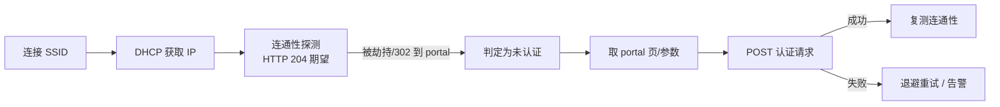

# 校园网（UESTC-WIFI）接入设计

> 对应 D3 / R4 / R5。设备走校园网而不是宿舍自装 WiFi，意味着**"联网"这一步本身就需要认证**，必须当作独立子系统设计。
> 本文给出判定方法、三种认证场景的实现方案、保活自愈机制与风险备选。

---

## 1. 为什么这件事重要

设备每天 22:00 必须处于**"已连上 UESTC-WIFI 且已通过校园网认证，能访问 jzsz.uestc.edu.cn"**的状态。校园网通常有两种（或叠加）认证：

| 场景 | 认证层 | 能否用 ESP32 实现 | 风险 |
| --- | --- | --- | --- |
| A · 开放 SSID + **Portal（Web 认证）** | 应用层 HTTP | ✅ 可实现（复现登录 POST） | 中：Portal 参数/加密方式各异 |
| B · **WPA2/WPA3-Enterprise（802.1X）** | 链路层 EAP | ✅ 可实现（`esp_eap_client`） | 低–中：需正确填写 EAP 字段，可能要装 RADIUS CA |
| C · **1X + Portal 双层** | 两者 | ✅ 可实现（先 1X 后 Portal） | 中：两套逻辑都要维护 |
| D · 需 MAC 自注册 / 客户端插件 | — | ⚠️ 需先在校园网自助平台注册设备 MAC | 中：需你手动注册一次 |

---

## 2. 第一步：判定你所在宿舍的 UESTC-WIFI 属于哪种

在**宿舍现场**用 Windows 电脑连上 UESTC-WIFI，执行：

```powershell
netsh wlan show interfaces
netsh wlan show profiles
netsh wlan show profile name="UESTC-WIFI" key=clear
```

判读 `netsh wlan show profile` 输出中的关键字段：

| 输出字段 | 值 | 结论 |
| --- | --- | --- |
| 身份验证 / Authentication | `开放式` / `Open` | → **场景 A**（Portal） |
| | `WPA2-企业` / `WPA2-Enterprise` | → **场景 B**（802.1X） |
| | `WPA3-企业` | → 需确认 ESP-IDF 版本支持（v5.2+ 支持 WPA3-Enterprise 192 位模式有限制，需实测） |
| 加密 / Cipher | `CCMP` | 正常 |
| 802.1X / EAP 类型 | `PEAP`、`TTLS` | 对应 IDF 的 `esp_eap_client` 配置 |
| 第二阶段身份验证 | `MSCHAPV2`（最常见）或 `MSCHAP`/`PAP` | IDF 支持 |
| 网络身份验证方法 / 是否要求服务器证书 | 「不验证服务器身份」/「验证服务器证书」 | 若要求验证，需提取 RADIUS CA 证书装进设备 |

**另外**：连上后如果浏览器自动弹出/跳转一个登录页 → 说明存在 Portal 层（场景 A 或 C）。

> Portal 也建议用 Burp 抓一次（`docs/capture-guide.md` Stage 9），常见实现有深澜 Srun、城市热点 Dr.COM、锐捷、华为等，参数各不相同。

### 2.1 实测记录（2026-10-13，另一台笔记本）

```text
netsh wlan show profile name="UESTC-WIFI" key=clear
  名称 : UESTC-WiFi        连接模式 : 手动连接      MAC 随机化 : 禁用
  身份验证 : 开放式          密码 : 无              安全密钥 : 不存在
```

**判读**：`开放式 + 无密码` 说明**无线链路层（L2）不需要口令** —— 设备可以"直接关联"，这对应 **场景 A**。

> ⚠️ **但"不需要密码"≠"不需要身份验证"**。校园网普遍是"开放 SSID + **Portal 网页认证**"：关联、DHCP 都正常，
> 但未认证时所有 HTTP 会被劫持到登录页，HTTPS/业务接口根本通不了。`netsh show profile` 只反映**本机保存的配置文件**，
> 不是网络的强制策略，必须用下面的命令做权威判定。

**权威判定（连接该 SSID 后，30 秒）**

```powershell
netsh wlan show networks mode=bssid          # 看该 SSID 那一行的"身份验证"（AP 广播的真实值）
netsh wlan show interfaces                   # 确认已连接、拿到 IP
curl.exe -i http://connect.rom.miui.com/generate_204
```

| `generate_204` 结果 | 结论 |
| --- | --- |
| `204 No Content` | ✅ 已放行，**当前网络无需 Portal**（可直接给设备用） |
| `302`（`Location` 指向 portal 域名）或返回一段 HTML 登录页 | ❌ 需要 Portal 网页认证（场景 A/C），设备必须实现 Portal 才能上网 |
| 超时 / 无法解析 | 链路或 DHCP 有问题 |

**设备侧同样可以一键判定**：蓝牙控制台执行 `netcheck`（等价于 `http http://connect.rom.miui.com/generate_204`），
看回执的 `status` 与 `location` 即可 —— 无需在手机上装任何工具。

> 📌 **对固件的含义**：ESP32 关联开放网络没问题（`wifi.set` 的 `pass` 传空字符串即可，固件已允许），
> 但**Portal 认证尚未实现**（见 §3）。因此——
> ① 若宿舍用的是**自己装的路由器**（WPA2-PSK），直接 `wifi <ssid> <密码>`，最省事，推荐；
> ② 若必须走校园网 SSID 且 `netcheck` 显示被劫持，则需按 §3 抓包并实现 Portal 认证后才能联网打卡。
> 另外注意 **ESP32-S3 只支持 2.4 GHz**，而 `netsh` 里常见的 `*_5G` 配置文件设备用不了。

### 2.2 实测记录（2026-10-13 11:17，宿舍现场）

```text
netsh wlan show networks mode=bssid
  当前有 1 个网络可见。
  SSID 1 : UESTC-WiFi     身份验证 : 开放式     加密 : 无
    BSSID 1 : a0:70:b7:xx:xx:xx   信号 80%   波段 : 5 GHz   频道 : 149   802.11ax
netsh wlan show interfaces → 已连接 UESTC-WiFi（5 GHz / 频道 149）
curl.exe -i http://connect.rom.miui.com/generate_204
  HTTP/1.1 204 No Content   (Server: MiFE/3.5.10)
```

**三个结论（其中第 3 条是必须实测的疑点）**

| # | 结论 |
| --- | --- |
| 1 | **当前没有 Portal**：`generate_204` 返回 `204`（未被劫持）⇒ 这条链路上不存在网页认证拦截，**固件无需实现 Portal 即可上网**（⚠️ 见第 3 条） |
| 2 | **现场只有 5 GHz**：只扫到 1 个 BSSID，5 GHz / 频道 149 / 802.11ax。**ESP32-S3 只支持 2.4 GHz（1–13 频道）**，因此按现场情况**设备连不上这个 SSID** —— 这是当前方案最硬的阻碍 |
| 3 | ⚠️ `204` 只证明**这台 PC 的 MAC（已打码）已被放行**。校园网关的免认证可能按时长维持、也可能是 MAC 白名单，**换一个新 MAC 的设备未必同样免认证** ⇒ 必须用**设备自己**跑 `netcheck` 才算数 |

**下一步实测（设备侧，约 10 分钟）**

```powershell
> wifi.scan        # 关键：2.4 GHz 里到底有没有 UESTC-WiFi（回执里看 ssid/channel，1–13 才是 2.4 G）
> wifi UESTC-WiFi  # 若可见：开放网络可省略密码（固件允许空密码，控制台已支持）
> netcheck         # 204 = 设备同样免 Portal；302/HTML 登录页 = 需要实现 Portal（§3）
> chain 0          # 确认登录/授权链路（窗口内才有意义）
```

**最终方案决策树**

| 现场情况 | 方案 | 说明 |
| --- | --- | --- |
| 2.4 G 有 `UESTC-WiFi` 且设备 `netcheck` = 204 | ✅ **首选** | `wifi UESTC-WiFi`（空密码）即可；开放网络 + 无 Portal + 无 802.1X，最贴近原设计 |
| 2.4 G 没有 `UESTC-WiFi`（现场只有 5 G） | ⚠️ 用**宿舍自装路由器**或**常开手机热点**（2.4 G / WPA2-PSK） | `wifi <ssid> <密码>`；**必须验证平台是否接受非校园网来源 IP**（`chain 0` / `checkin`，即 §7 风险项） |
| 只能 5 G 且必须走校园网 | 加 **2.4 G 中继**（旧手机热点 / 迷你路由器桥接）或改硬件（USB 以太网） | ESP32-S3 无法直接连 5 GHz |
| 设备 `netcheck` 出现 302 / HTML 登录页 | 实现 **Portal 认证**（§3）：抓包 → 复现 POST（注意 `chksum` / JS 参数） | 目前证据下**不必实现**，作为兜底 |

---

## 3. 场景 A：Portal 认证实现

### 3.1 设备侧流程



### 3.2 关键实现点

| 点 | 做法 |
| --- | --- |
| 探测是否被劫持 | 请求 `http://connect.rom.miui.com/generate_204`（或 `http://www.gstatic.com/generate_204`）并检查：返回 204 = 已认证；返回 302 且 `Location` 指向 portal 域名 = 未认证；连接超时 = 网络异常 |
| 取 portal 参数 | 多数 Portal 需要先 GET 一个页面拿到 `wlan_user_ip`、`nas`、`token`、`challenge` 等；个别实现是纯 JS 拼接（**需关注是否有 JS 加密/校验和**） |
| 提交认证 | 通常是 `GET/POST` 一个 URL，参数如 `user_account`、`user_password`、`ac_id`、`nas_ip`、`wlan_user_ip`、`chksum` |
| 校验和 | 若存在 `chksum`（深澜常见为 MD5 拼接），ESP32 用 mbedTLS 的 MD5 即可实现；**算法必须由抓包确认** |
| 密码提交形式 | 有的明文、有的 Base64、有的 AES；确认后按同样算法实现（与 CAS 密码加密共用 `crypto` 能力） |
| 认证有效期 | Portal 会话常有时长上限（几小时~一天）与空闲超时 → 必须**周期保活**，见 §4 |

### 3.3 若 Portal 需要执行 JS 才能生成参数

则设备侧不可行（同 R1）。备选：
1. 在 Python 侧把参数算法复现出来（多数情况可行）；
2. 退化为"宿舍有线口 + PPPoE/自动获取"（如果宿舍网口不需要 Portal）；
3. 使用手机热点作为保底联网手段（注意：可能因此不在校园网内，需确认平台是否校验来源 IP——抓包时已通过 `x-forwarded-for` 之类字段或实测确认）。

---

## 4. 场景 B：802.1X（WPA2-Enterprise）

ESP-IDF 的配置项（`esp_eap_client` / `esp_wifi_sta_enterprise`）：

| ESP-IDF 字段 | 对应 `netsh` 输出 | 说明 |
| --- | --- | --- |
| `identity` | 匿名身份（常为空或 `anonymous@uestc.edu.cn`） | 多数情况填学号或不填 |
| `username` | 网络身份验证用的用户名 | 通常为学号 |
| `password` | 密码 | 与统一身份认证密码可能相同 |
| `eap_method` | PEAP / TTLS | 二选一 |
| `phase2_method` | MSCHAPv2 / MSCHAP / PAP | 必须与网络一致 |
| `ca_cert` | 「验证服务器证书」时需提供 | 从 Windows 证书存储导出 RADIUS 服务器 CA 的 PEM |
| `domain` / CN 校验 | — | 若证书 CN 与配置不符会连接失败 |

**实现模式（推荐）**：把 EAP 参数当作普通配置项存 NVS，通过 BLE 写入（与 WiFi SSID/密码同一套配置通道），这样换宿舍/换网络都不用改固件。

**证书校验取舍**：

| 选项 | 安全性 | 建议 |
| --- | --- | --- |
| 提供 RADIUS CA 并严格校验 | 高 | ✅ 推荐（需导出 PEM，放 assets 分区） |
| 不校验服务器证书（IDF 中不配置 CA） | 低（可被伪造 AP 钓鱼） | 仅在无法导出证书时临时使用，并在 `runbook.md` 中记录风险 |

**其他注意**：802.1X 断线后需要重新走 EAP 握手（IDF 会自动重连），代码中要监听 `WIFI_EVENT_STA_DISCONNECTED` 并立即触发重连退避。

---

## 5. 场景 C：1X + Portal 叠加

顺序固定：**先完成 802.1X 关联 → 再做 Portal 认证**。设备侧把两者实现为串行的两个阶段，任一失败都进入重试队列。代码结构上 `wifi_auth` 提供一个统一的 `net_ensure_online()`：

```c
typedef enum { NET_OK, NET_NO_AP, NET_EAP_FAIL, NET_PORTAL_FAIL, NET_TIMEOUT } net_result_t;
net_result_t net_ensure_online(uint32_t timeout_ms);
```

上层（`sched` / `checkin`）只调用这一个函数，不关心底层是哪种认证。

---

## 6. 保活与自愈

| 机制 | 参数 | 说明 |
| --- | --- | --- |
| 周期探测 | 每 5 分钟 | `generate_204` 探测；连续 2 次失败才判定异常（避免抖动误判） |
| 认证态判定 | 302 → portal | 自动触发 Portal 重认证；1X 层掉线则由 WiFi 事件驱动重连 |
| 退避策略 | 1 s → 2 s → 4 s → … → 60 s 封顶 | 避免风暴；成功后重置 |
| 打卡前强制体检 | 21:00（窗口一开始） | 连不上就在窗口内持续修复；修复失败立即告警（LED + Webhook） |
| 保活流量最小化 | 探测间隔 5 min、报文 < 1 KB | 校园网通常有流量/在线时长策略，避免被判定异常 |
| 日志 | 每次探测结果记入环形日志 | 便于事后诊断"为什么那天没打上" |

---

## 7. 风险与备选

| 风险 | 说明 | 备选方案 |
| --- | --- | --- |
| MAC 需自注册 | 部分校园网要求先在自助平台登记设备 MAC | 从设备日志/BLE 读出 MAC，手动注册一次 |
| 设备数限制 | 单账号在线设备数有限（如 3 台） | 让设备替代某个不常用设备；或改用宿舍有线口 |
| 仅 5 GHz 覆盖 | ESP32-S3 只支持 2.4 GHz | 实测 2.4 G 是否可用；不可用则只能走有线口/其他网络 |
| 夜间断网/限速 | 部分宿舍楼 23:30 后限速或断网 | **实测**；若 22:00 前断网则方案需调整打卡时间 |
| 会话每日强制下线 | 需要在 22:00 前重新认证 | 已由 §6 保活覆盖 |
| Portal 需 JS 参数 | 设备侧不可行 | 见 §3.3 |
| 平台校验来源 IP | 2026-10-13 实测**已排除**：设备与 PC 都在校园网，且"已授权会话"可从任意客户端用极简头重放成功（见 `docs/api-contract.md` §8.6） | — |

---

## 8. 需要你提供的实测数据（对应 C5 / C6）

- [x] `netsh wlan show profile name="UESTC-WIFI" key=clear` 的完整输出（**密码可打码**）→ **已提供（2026-10-13）**：`身份验证=开放式 / 密码=无` ⇒ 场景 A（开放 SSID + Portal）；是否真有 Portal 仍需 `generate_204` 判定，见 §2.1
- [ ] 连接后是否弹出 Web 登录页（有/无）→ 可用设备侧 `netcheck` 一键判定（§2.1）→ **PC 侧结论：无 Portal（`generate_204` = 204，见 §2.2）；设备侧待复核**
- [ ] 若有 Portal：`docs/capture-guide.md` Stage 9 的抓包结果 → **目前无需**（§2.2 结论 1）
- [ ] 宿舍内 2.4 GHz 是否可见（Windows `netsh wlan show networks mode=bssid` 输出）→ **2026-10-13 现场只扫到 5 GHz**（§2.2）；须用设备 `wifi.scan` 复核
- [ ] 设备是否需要在校园网自助平台注册 MAC；当前账号在线设备数上限
- [ ] 夜间（22:00 后 / 23:30 后）网络是否正常（可观察 2–3 天）
