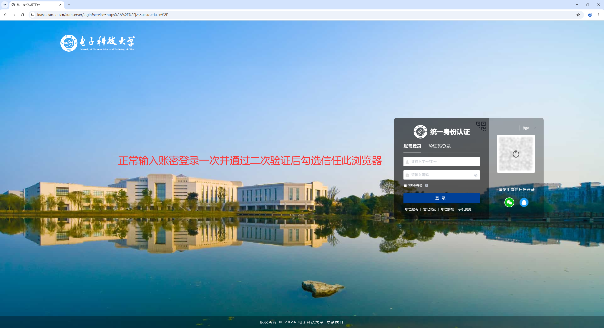
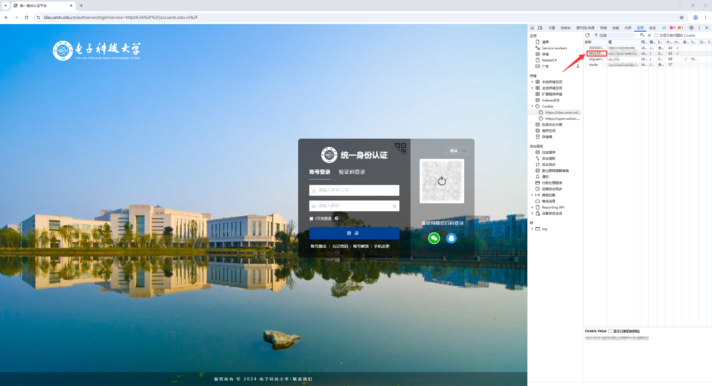
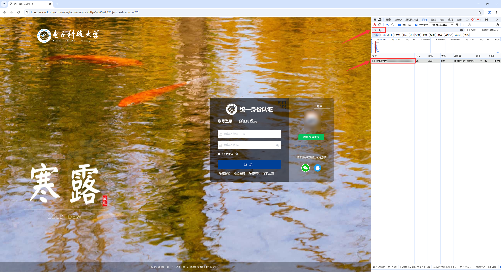
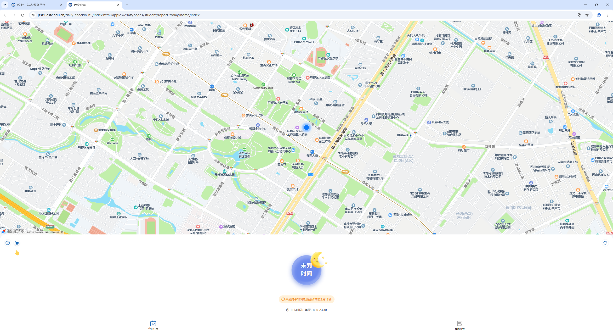
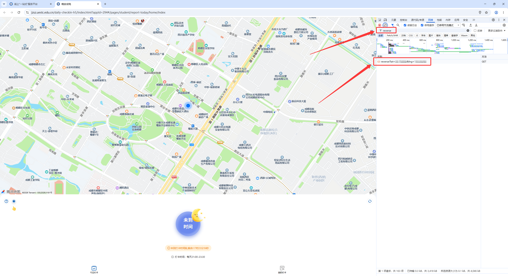
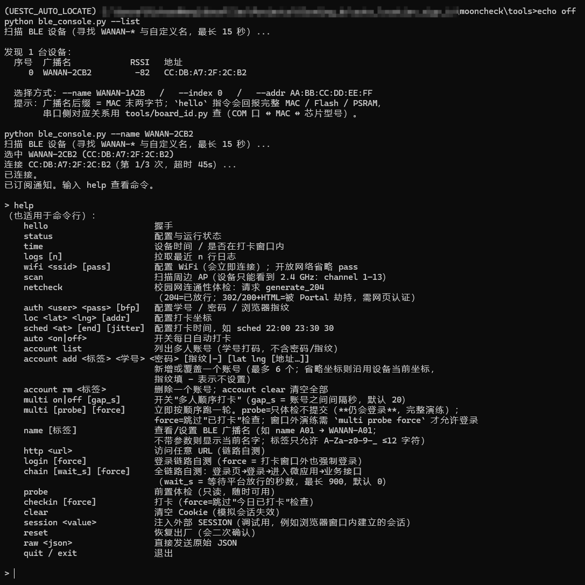
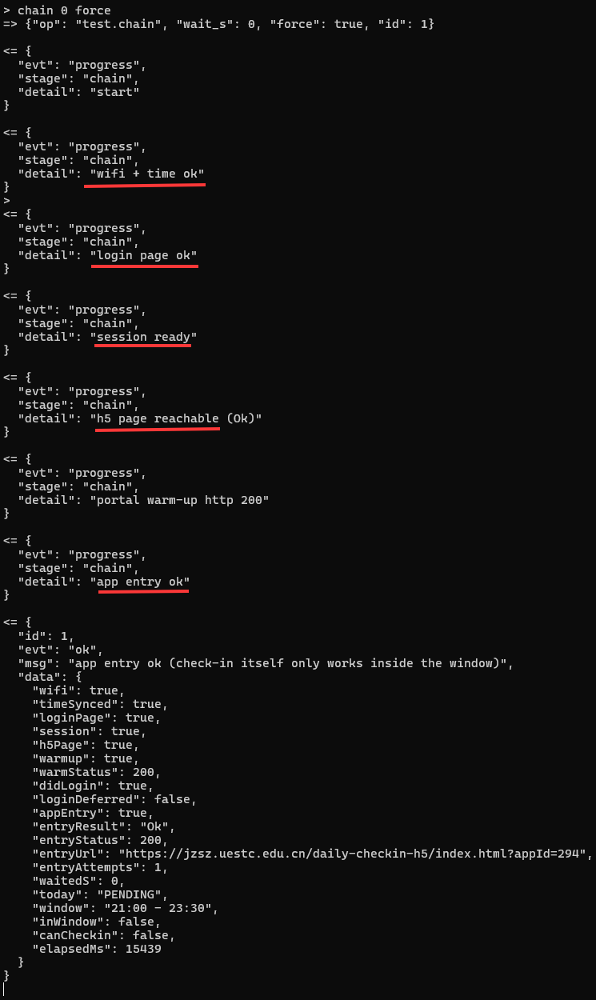

# 晚安成电自动打卡终端 · 同学上手指南

> 你手上应该有一块**已经烧好固件**的开发板。这份指南带你从零配好它，之后每晚 22:00 自动打卡，不用再管。
> 全程只需要：**一台能上网的电脑 + Chrome + 一根 USB 线**，不需要装 Arduino、不需要编译、不需要抓包工具。

---

## 0. 你需要准备什么

| 类别 | 内容 |
| --- | --- |
| 硬件 | 打卡板 1 块（已烧录固件）、USB 数据线 1 根、供电口（电脑 USB 或 5V 充电头） |
| 软件 | Python 3.12 + `bleak` 包 + `ble_console.py`（配置用的中控台，单文件） |
| 信息 | 你的**学号 / 统一身份认证密码**、宿舍 WiFi 名与密码、你自己浏览器里的**指纹值**、你宿舍的**经纬度** |
| 时间 | 约 10 分钟；**其中"取坐标"必须在宿舍现场做** |

> 📌 只要 `ble_console.py` 这一个脚本，它只依赖 `bleak`，不依赖仓库里的其他东西。

---

## 1. 软件环境

### 1.1 直接装（简单场景）

```powershell
python --version                 # 需要 3.10+，推荐 3.12
python -m pip install bleak
```

### 1.2 用 conda（你已经有 conda、不想污染 base 环境时推荐）

```powershell
conda create -n WANAN python=3.12 -y
conda activate WANAN
python -m pip install bleak
python -c "import bleak; print('bleak OK', bleak.__version__)"
```

> 💡 以后每次用之前都要先 `conda activate WANAN`。

<!-- 配图 1：终端里 conda activate 后执行 pip install bleak 成功的截图 -->


---

## 2. 硬件与供电（⚠️ 必须 5V）

| 要求 | 说明 |
| --- | --- |
| **电压必须是 5V** | 从板子的 **5V / VIN 引脚**输入。**绝对不能接 3.3V 以外的更高电压，也不要把它当 3.3V 用** |
| 电流 | 建议 ≥ 500 mA（WiFi 发射瞬间有峰值，用 100~200 mA 的小口容易反复重启） |
| **没有供电方案时 → 直接插电脑 USB** | 最省事、最稳：Type-C 插电脑即可，同时还能看串口日志 |
| 长期挂机 | 用 5V/1A 手机充电头 + 插座，或充电宝（注意有些充电宝小电流会自动断电） |
| 接线供电（DIY） | USB 的 **红=5V、黑=GND** 接板子 `5V`/`GND`；**别接错**，接反会烧 |

正常上电的现象：**板载灯亮起 / 蓝牙能被搜到**。如果板子反复重启（灯一闪一闪），先换一根线或换 5V/1A 头。

<!-- 配图 2：板子接电的正确示范（标注 5V 与 GND 位置；用 USB 直插电脑的情况也拍一张） -->


---

## 3. 操作步骤总览

```
① Chrome 登录统一身份认证  →  取 MULTIFACTOR_BROWSER_FINGERPRINT
② 在宿舍打开一次晚安成电    →  从 reverse 请求取你的经纬度
③ 用 ble_console.py 连上板子 → 配 WiFi / 账密 / 指纹 / 坐标 / 时间
④ 测链路：chain 0 →（窗口内）checkin → status
```

---

## 4. 第一步：取「浏览器指纹」值（免验证码的关键）

> 这个值决定了设备会不会向你要短信验证码。**必须用你平时打卡、并且登录过的那个浏览器**来取。

1. 用 **Google Chrome** 打开：`https://jzsz.uestc.edu.cn/`，正常登录统一身份认证
   （如果它要求"二次验证/短信验证码"，勾选**"信任此浏览器/不再提示"**再完成，这样才会生成指纹值）。

<!-- 配图 3：Chrome 打开 jzsz.uestc.edu.cn 并已登录成功的首页 -->


2. 按 **F12** 打开 DevTools → 切到 **应用(Application)** 标签 → 左侧 **Cookie** → 点开 `https://idas.uestc.edu.cn`。
3. 找到名为 **`MULTIFACTOR_BROWSER_FINGERPRINT`** 的一条，复制它的**值**（32 位十六进制，形如 `0 1 2 3 A B …`）。

<!-- 配图 4：DevTools → Application → Cookies → idas.uestc.edu.cn，高亮 MULTIFACTOR_BROWSER_FINGERPRINT 这一行 -->


> ⚠️ **它是 HttpOnly**：在 Console 里输 `document.cookie` **看不到它**，必须用上面的 Application → Cookies 面板。
> 🔎 备用取法：DevTools → **网络(Network)** → 过滤 `bfp` → 找一条 `GET /authserver/bfp/info?bfp=XXXXXXXX...` 的请求，URL 里 `bfp=` 后面那串就是它。

<!-- 配图 5：Network 里 bfp/info 请求的 URL 参数（备用取法） -->


> 🔒 **这个值等于"免验证码的钥匙"**，不要发到群里、不要截图带完整值、不要提交到网盘/GitHub。

---

## 5. 第二步：取你宿舍的坐标（必须在宿舍做）

1. **人在宿舍**，用 Chrome 打开晚安成电：平台首页点 **"晚安成电"** 图标，或直接访问
   `https://jzsz.uestc.edu.cn/daily-checkin-h5/index.html?appId=294`
   （登录状态没过期就能直接进；进去后页面会显示地图和"请打卡"）。

<!-- 配图 6：宿舍里打开晚安成电页面，能看到地图与"请打卡" -->


2. 按 **F12** → **网络(Network)** → 顶部过滤框输入 `reverse` → 找到形如
   `reverse?lat=30.7xxxxx&lng=103.9xxxxx` 的请求。
3. 点开它，在 **标头(Headers) → 请求网址(Request URL)** 里复制 `lat=` 和 `lng=` 后面的两个数字。

<!-- 配图 7：Network 过滤 reverse，选中该请求，右侧"标头"里高亮 Request URL 的 lat/lng -->


> ⚠️ **三个坑**：
> 1. **必须在宿舍现场取**——打卡围栏只有 **130 米**半径，人在别处取的坐标会打不上；
> 2. 这个坐标来自**浏览器的定位**（电脑没有 GPS，靠 WiFi 估算），**可能不准**。建议：
>    - 关掉再打开定位权限、或刷新页面多取 2~3 次，取**出现次数最多的那组**；
>    - 拿到的值可以到"高德地图 → 坐标拾取器"里粘一下，看落点是不是你宿舍楼附近；
>    - 如果 `reverse` 请求里的坐标明显在校园外/差很远，说明浏览器定位失败，先解决定位权限再取。
> 3. 坐标是 `lat,lng` 顺序（纬度在前），别写反。

---

## 6. 第三步：连上板子并配置

### 6.1 连接

```powershell
cd <你放 ble_console.py 的目录>
python ble_console.py --list          # 先看板子在不在（广播名 WANAN-XXXX）
python ble_console.py --name WANAN-XXXX
```
连上后会显示 `已订阅通知。输入 help 查看命令。`

<!-- 配图 8：--list 输出（显示广播名/RSSI/地址）与连接成功画面 -->


> 先确认通信正常：输入 `hello`，应回 `fw`、`mac`、`flashMB` 等字段。

### 6.2 依次输入这 5 条命令

```
wifi <宿舍WiFi名> <WiFi密码>
auth <你的学号> <统一身份认证密码> <第4步取到的32位指纹>
loc <lat> <lng> 四川省成都市郫都区
sched 22:00 23:30 30
auto on
```

示例（**数值全是占位示例，请换成你自己的**）：

```
wifi Dorm-2.4G mywifi123
auth 2023XXXXXXX ************ 0123456789ABCDEF0123456789ABCDEF
loc 30.753456 103.934123 四川省成都市郫都区
sched 22:00 23:30 30
auto on
```

<!-- 配图 9：控制台里逐条输入 wifi/auth/loc/sched/auto 并都收到 ok 回执 -->


**要点**

| 项 | 注意 |
| --- | --- |
| WiFi | **必须 2.4 GHz**！板子不支持 5 GHz。名字里带 `_5G` 的不行；如果宿舍只有 5 GHz 校园网，请改用自己路由器或手机热点（2.4G 频段）。不确定就先输 `scan`，看你的 SSID 对应 `channel` 是不是 1–13 |
| WiFi 名/密码含空格或特殊字符 | 用原始指令：`raw {"op":"wifi.set","ssid":"我的 WiFi","pass":"a b#c"}` |
| 指纹 | 一定要填，否则设备会被要求短信验证码（它没法自己收短信） |
| `loc` 第三个参数（地址） | 可随便填，只影响打卡记录里的地址文本 |
| `sched` | 第 1 个是打卡时间，第 2 个是窗口结束，第 3 个是随机抖动秒数 |

### 6.3 让板子联网并校时

`wifi` 命令会自动连接并校时，看回执：

```json
{"evt":"ok","msg":"wifi connected","data":{"ip":"192.168.1.xxx","rssi":-52,"timeSynced":true}}
```

再输 `time` 确认设备时间正确（应为当前北京时间，且在 `21:00 - 23:30` 窗口判断正确）。

---

## 7. 第四步：验证链路是否通

### 7.1 一条命令看全链路：`chain 0`

```
chain 0
```

期望回执（**关键字段**）：

```json
{
  "loginPage": true,     // 登录页可取、参数可解析
  "session": true,       // 已建立登录态会话
  "h5Page": true,        // 打卡界面可打开（静态页，任何时候都 true）
  "warmup": true,        // 门户预热成功（★授权的前提）
  "appEntry": true,      // ★平台已授权这个会话进入微应用
  "entryUrl": "https://jzsz.uestc.edu.cn/daily-checkin-h5/index.html?appId=294",
  "today": "PENDING",    // 今日还没打卡
  "window": "21:00 - 23:30",
  "inWindow": false,     // 当前是否在打卡时段（白天为 false 是正常的）
  "canCheckin": false    // = appEntry && session && inWindow
}
```

判读：

| 现象 | 含义 | 怎么办 |
| --- | --- | --- |
| `appEntry:true` + `canCheckin:false` + `inWindow:false` | ✅ **一切正常**，只是现在不是打卡时段 | 等到 21:00–23:30 即可 |
| `canCheckin:true` | ✅ 现在就能打 | 直接 `checkin` |
| `warmup:false` 或 `appEntry:false` | 会话没被授权 | 先 `login force` 再 `chain 0`；仍不行检查学号/密码/指纹是否填错 |
| `loginPage:false` | 网络/DNS/TLS 不通 | 先 `status` 看 `net.state` 与 `ip`，再 `netcheck` |
| `session:false` + `loginDeferred:true` | 窗口外没去登录（默认保护） | 用 `chain 0 force` 或 `login force` |

<!-- 配图 10：chain 0 的成功回执截图（高亮 appEntry:true） -->


### 7.2 真打一次卡（需在 21:00–23:30 内）

```
checkin
```
成功示例：
```json
{"evt":"result","ok":true,"msg":"checked in at 21:36:01 (distance 42.5 m)"}
```

| 返回 | 含义 | 处理 |
| --- | --- | --- |
| `ok:true … checked in at …` | ✅ 成功 | 完成 |
| `already checked in` | 今天已经打过 | 正常（幂等，不会重复提交） |
| `OUT_OF_WINDOW` | 不在 21:00–23:30 | 到点再试 |
| `NEED_MFA` | 服务端要验证码 | 指纹没配对，回第 4 步重新取 |
| `APP_UNAVAILABLE` / `pending` | 会话未被授权 | 等 3 分钟设备会自动重试；手动可再 `login` + `checkin` |
| `distance` 很大 / 被打异常 | 坐标不对 | 回第 5 步在宿舍重新取坐标：`loc <新lat> <新lng>` |

### 7.3 收尾确认

```
status
```
看到这些就算配好了：

```json
"net":{"state":"connected","timeSynced":true,"deviceTime":"2026-10-15 22:00:07"},
"cfg":{...,"schedule":{"checkinAt":"22:00","autoDaily":true}},
"schedule":{"nextRun":"2026-10-16 22:00:xx"},
"last":{"date":"2026-10-15","ok":true,"message":"checked in at 22:00:07 (distance 42.5 m)"}
```

**之后就不用管了**：每天 21:00 自动预登录、22:00 自动打卡、失败每 3 分钟重试到 23:30；掉电重启会自动重连并继续。

<!-- 配图 11：status 回执，高亮 last.ok:true 与 nextRun -->


---

## 8. 常见问题速查

| 现象 | 原因 | 解决 |
| --- | --- | --- |
| `--list` 里看不到设备 | 板子没上电 / 已被手机 nRF 等占用 / 电脑蓝牙没开 | 重新上电；关掉其他 BLE 工具；重开蓝牙开关 |
| 连接超时 / `Could not get GATT services` | **多数是 Windows 侧问题**（旧 GATT 缓存、射频弱） | ① 设置→蓝牙→删除该设备再重连；② 管理员 PowerShell 执行 `Restart-Service bthserv`；③ 把板子拿到电脑旁边；④ 台式机确认机箱后**天线已拧上**；⑤ 换手机 nRF Connect 验证（手机能连=PC 侧问题） |
| 连上了但 `wifi` 一直失败 | 5 GHz / 密码错 / 名字含空格 | 确认是 2.4 GHz；含空格用 `raw {"op":"wifi.set",...}` |
| `wifi` 成功但 `netcheck` 返回 302/HTML | 校园网需要网页认证（Portal） | 换用不需要 Portal 的网络（自装路由器 / 手机热点） |
| `login` 报 `NEED_MFA` | 指纹没填或填错，或该账号从未"信任浏览器" | 用**平时打卡那个浏览器**重新取指纹（第 4 步），并在登录时勾选"信任此浏览器" |
| 白天 `chain 0` 显示 `inWindow:false` | 正常，打卡窗口是 21:00–23:30 | 到点自动打 |
| 打卡记录显示"异常" | 坐标偏差大 | 在宿舍重新 `loc` |
| 想重置重来 | — | `clear`（只清 Cookie）；`reset`（恢复出厂，会二次确认） |

---

## 9. 安全提醒（重要）

- **学号密码 + 指纹值 = 你的账号通行能力**：只通过私聊发给对方，不要发群、不要上传网盘、不要提交到 GitHub。
- 配置只存在板子的存储区里，`status` 输出会自动打码（学号只留前 4 位，密码/指纹只报"是否已设置"）。
- 设备不需要外网账号权限，只调用学校打卡接口；不要拿它做别的用途。
- 建议把板子放在**宿舍里 WiFi 信号好的位置**长期通电（它靠固定坐标打卡，不需要移动）。

---

## 10. 附录：常用命令一览

| 命令 | 作用 |
| --- | --- |
| `hello` / `status` / `time` | 版本与 MAC / 全量状态 / 设备时间与窗口 |
| `logs 30` | 拉最近 30 行设备日志（排查用） |
| `wifi <ssid> [pass]` | 配 WiFi（开放网络可省密码） |
| `scan` | 扫描周边 AP（设备只能看到 2.4 GHz，`channel` 为 1–13；等价 `raw {"op":"wifi.scan"}`） |
| `netcheck` | 判断当前网络是否需要网页认证 |
| `auth <user> <pass> [bfp]` | 配学号/密码/指纹 |
| `loc <lat> <lng> [addr]` | 配宿舍坐标 |
| `sched <at> [end] [jitter]` | 配打卡时间 |
| `auto on|off` | 开关每日自动打卡 |
| `login [force]` / `probe` / `chain [秒] [force]` / `checkin [force]` | 手动登录 / 只读体检 / 全链路自检 / 打卡 |
| `session <值>` | 注入浏览器会话（应急） |
| `name <标签>` | 给这块板起个好认的蓝牙名（如 `name A01` → `WANAN-A01`） |
| `raw <json>` | 直接发原始指令 |
| `quit` | 退出（配置不会丢） |

> 🧑🤝🧑 **一台板子帮多个人打卡**？那是"多人顺序打卡版"固件（`env:esp32-s3-multiuser`），
> 用 `account add` / `multi` 系列命令，详见仓库内 `docs/multi-user-design.md`。

---

### 配图清单（拍摄/截图对照表）

| # | 文件名 | 要拍什么 |
| --- | --- | --- |
| 1 | `01-pip-install-bleak.png` | conda 建环境 + `pip install bleak` 成功 |
| 2 | `02-power-5v.png` | 板子供电方式（USB 插电脑 / 5V 充电头 / 接线标注） |
| 3 | `03-login-jzsz.png` | Chrome 已登录 `jzsz.uestc.edu.cn` 首页 |
| 4 | `04-cookie-fingerprint.png` | DevTools → Application → Cookies → `idas` 域，高亮 `MULTIFACTOR_BROWSER_FINGERPRINT` |
| 5 | `05-bfp-info-url.png` | 备用取法：Network 里 `bfp/info?bfp=…` 请求 |
| 6 | `06-h5-page.png` | 宿舍里打开晚安成电，能看到地图和"请打卡" |
| 7 | `07-reverse-coords.png` | Network 过滤 `reverse`，Request URL 里的 `lat`/`lng` |
| 8 | `08-ble-connect.png` | `--list` 结果 + 连接成功提示 |
| 9 | `09-config-commands.png` | 依次输入 wifi/auth/loc/sched/auto 都回 ok |
| 10 | `10-chain-ok.png` | `chain 0` 回执，高亮 `appEntry:true` |
| 11 | `11-status-done.png` | `status` 回执，高亮 `last.ok:true` 与 `nextRun` |

> 图片放到与本文件同级的 `assets/quickstart/` 目录下即可；如果只发单文件，把图片改成在线链接或直接删掉 `![...]` 行也不影响阅读。
